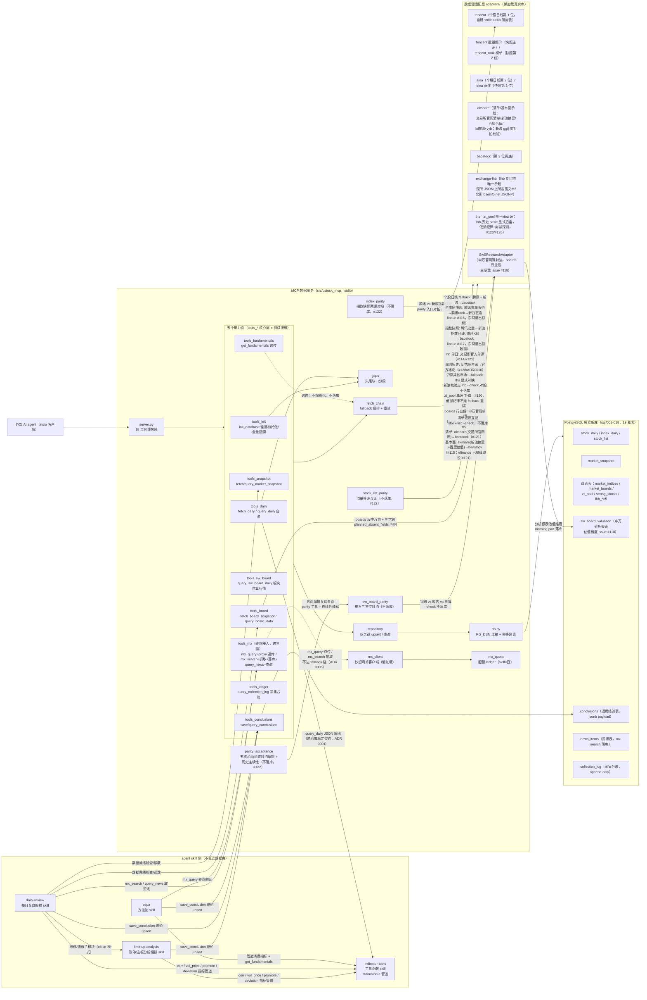

# 项目知识图谱

面向人类与 AI agent 的 5 分钟全图认知。术语遵循 `CONTEXT.md`（抓取/落库/透传/自愈/回溯/五个能力面）。
每条论断尽量标注来源（`path:line`）。设计决策的"为什么"在 `docs/adr/0001-0015`，本图只讲"是什么、在哪、和谁相连"。

## 总览图

## 实体清单

### MCP server 入口与公共层

- **`server.py`**：stdio MCP server，18 个工具只做薄包装，核心逻辑全在 `tools_*` 模块（`src/qstock_mcp/server.py:1-5`）；数据库连接按工具调用建立，启动不依赖 PG 可达（`server.py:4`）。入口 `qstock-mcp = qstock_mcp.server:main`（`pyproject.toml:17`）。
- **`output.py`**：统一错误输出契约——`status:"error"` + 工具名 + 参数回显 + 原因，工具层不抛异常（`output.py:4-6`、`db.py:31-41`）。
- **`dates.py`**：日期统一 `yyyymmdd`（接受 `yyyy-mm-dd`）；`days` 按交易日≈自然日 7/5 加 buffer 换算区间，宁多抓不少抓，换算落点是非交易日时 start 向前对齐到最近交易日（周末 + `_MARKET_CLOSURES` 已知休市表，issue #51）（`dates.py:62-73`、`dates.py:75-97`）。`is_trading_time`/`today_str`：交易时段判定（交易日 09:30–15:00 东八区），盘中禁写防线（issue #78）的判定内核，时钟可注入。`trading_day_window` 为 CLI 的 `--trading-days N` 生成含截止日在内的 N 个交易日闭区间，缺省截止最近已收盘交易日。
- **`db.py`**：连接串只从 `PG_DSN` 环境变量读（ADR 0002）；`ensure_schema` 幂等执行 `sql/*.sql` 全部 DDL（`db.py:21-28`、`db.py:44-54`）。

### 五个能力面（核心层 = 第一测试接缝，测试注入 fake 适配器 + 真实 PG 测试库）

- **init — `tools_init.py`**：轻量初始化 = 幂等建表 + 股票清单 + 全市场快照 + 7 个主要指数全历史日线，三部分独立成败，输出 `parts`/`failed_parts`，仅全败才整体 `error`（`tools_init.py:1-13`、`tools_init.py:168-219`、ADR 0004）。`backfill_history=True` 显式开启全量回溯：以 `stock_list` 为标的来源、固定 qfq、复用日线头尾自愈、单股失败不中断（`tools_init.py:117-165`）；个股日线回溯走 `default_daily_adapters`（腾讯→新浪→baostock，issue #112；腾讯 640 根/请求，全历史逐股约 19 次请求，重操作）；全市场快照部分走 `default_snapshot_adapters`（issue #116，腾讯批量报价→腾讯 rank→新浪，注入适配器时沿用同一组 fake）；指数日线部分走 `default_index_daily_adapters`（issue #117，腾讯→baostock，注入适配器时沿用同一组 fake；盘中禁写 defer 保持）。`query_index_daily` 为 index_daily 纯读查询（issue #33/T1）：index_code 限 7 个主要指数（白名单校验，未知代码 error 并列可选项），日期闭区间 + limit 取最近 N 行（缺省 120）升序返回，空结果 `count:0` 非错误，不触发补抓（`tools_init.py:224-284`）。**能力面归统一查询**（`CONTEXT.md`），实现暂驻 tools_init：与写入方 `_init_index_daily` 同模块共享 `MAJOR_INDICES` 白名单/指数名，迁往 tools_daily 会与 tools_init→tools_daily 的 `ensure_coverage` 依赖成环。`import_board_classification`（issue #73，spec #70）：成分字典显式导入入口，以文件为准清空重载某 source_system（事务内删除后重载、陈旧行不残留、重复执行幂等），本期仅 'sw'（申万 .xls，解析在 `_sw_classify.py` 纯函数、xlrd 懒加载，股票代码补零 6 位）；采集台账挂接点 `_ingest_ledger_hook` 已预留（台账表 #71 落地后接线）。`import_sw_industry_meta`（issue #74）：申万行业名称表种子导入，仓库内置 CSV 种子（`data/sw_industry_meta.csv`，加载在 `_sw_classify.load_sw_industry_meta_seed`）按 industry_code 幂等 upsert，只动 meta 不碰成分变更史；来源验证与合并规则见 `docs/research/2026-10-17-sw-industry-meta-sources.md`。。`refresh_sw_dict`（issue #118，spec #111）：成分字典在线刷新——申万官网分类 xls 直链下载（`SwBoardsAdapter.fetch_sw_class_file`）→ 临时文件 → 复用 `import_board_classification` 事务清空重载 'sw' 体系（含北交所归属），把 issue #73 的手工文件导入升级为在线刷新（`qstock-scheduler sw-dict`），重复执行幂等。
- **fetch/query 日线 — `tools_daily.py`**：`ensure_coverage` 默认只补请求区间头尾缺口（中段缺口视为停牌），`fetch_daily(force=True)` 时整窗重抓；是全量回溯与查询自愈共用的公共能力（`tools_daily.py:24-48`）；个股日线 fallback 链为 **腾讯 → 新浪 → baostock**（issue #112，`default_daily_adapters`；东财日线退役，akshare `fetch_daily` 显式 `unsupported`），北交所旧码 43x/83x/87x 经 `adapters/_bse_codes.py` 按官方 248 条对照表归一化到 920 新码；三源对拍在独立模块 `daily_parity.py`（`compare_daily_sources`）：逐源直取同日 bar 做字段级对拍、不落库，hfq 只比量/额/换手率（CLI `daily --check`）。`fetch_daily` 与 `query_daily` 共用 `_run` 骨架（参数解析→连接→自愈），前者报告 upsert 行数，后者返回完整区间行（`tools_daily.py:67-147`）。盘中禁写（issue #78）：交易时段内当日行不落库（defer 机制，fetch 报告 deferred 计数、query 把盘中行随响应返回并带 note）。停牌标注（issue #80）：`query_daily` 每行带 `tradestatus`（baostock 权威，其余源 null）+ `suspended`/`suspended_basis`（tradestatus 优先，OHLC 全等且 volume/change_percent 为 null 的启发式兜底），停牌占位行与数据缺失行由此可区分。
- **fetch/query 快照 — `tools_snapshot.py`**：全市场快照单次调用约 5000+ 只；fallback 链（issue #116，spec #111）为 **腾讯批量报价（qt.gtimg.cn，主源）→ 腾讯 rank 榜单 → 新浪直连**，东财链路退出快照承载，生产默认 `default_snapshot_adapters`（`adapters/__init__.py`）；主源 18 字段全覆盖、时间戳含日期可过 #78 带参防线，需股票清单驱动（默认提供者 `adapters/_snapshot_codes.py`：akshare 交易所官网清单 → 库内 stock_list 兜底，双路皆失败转 rank）；rank 免清单但缺 OHLC/pre_close（涨跌家数口径改由 change_percent/zdf 判定），新浪直连绕过 akshare 封装（其丢 7 字段）且 ticktime 无日期。交易日优先级：API 报告 > 传入参数 > 当天，但传入日期与 API 生效日期不符（含 API 未报告）即 error + `detail:date_mismatch` 零落库（issue #78 防线，"API 优先"仅限不传参）（`tools_snapshot.py:80-85`）。三态错误契约首个落地（issue #46，ADR 0007）：全源失败按逐源 `failure_kind` 聚合 `error_kind`——任一抓取源连接级故障即 `upstream_unreachable`（带 `retry_advice`），否则 `fetch_failed`；by-design 不支持的源不参与判定；上游正常响应空结果为 `no_data_for_date`（status ok + `empty_kind` + note，非失败）。`query_snapshot` 服务端聚合与排序取前 N（issue #48）：`aggregate=breadth,amount` 聚合模式返回上涨/下跌/平盘家数（有昨收按最新价 vs 昨收判定，昨收缺失改由 change_percent 判定，issue #116；含沪/深/北分市场口径——代码前缀 6 沪 / 4·8·9 北，同 `is_bse_code` / 其余深）与成交额合计（万元，ADR 0006），不返回行，环比由调用方对当日/前一日各调一次完成；`order_by`（快照列白名单）+ `limit=N` 排序取前 N（`order` asc/desc 缺省 desc），行字段与整表查询一致不裁剪列；聚合与 ORDER BY/LIMIT 均下推 SQL，新参数与 `trade_date`/`stock_code` 正交、不传行为不变；明确不做通用 offset 分页（防翻页拼全表）。三源字段级对拍在独立模块 `snapshot_parity.py`（`compare_snapshot_sources`）：逐源直取同日快照比对、不落库，结构性缺项跳过（rank 缺 OHLC/pre_close、新浪缺振幅/量比），差异含已知 PE 口径切换信号（CLI `snapshot --check`）。
- **fetch/query 盘面 — `tools_board.py`**：五 section（indices/boards/zt_pool/strong_stocks/lhb）独立 fallback、独立 commit 落库（中途失败不回滚、按 trade_date 幂等、可用 sections 参数分段重试）。核心 section 集显式声明为 `CORE_SECTIONS = indices/boards/zt_pool/strong_stocks`（lhb 永不进核心集，issue #47）：任一核心 section 因 upstream_unreachable 失败即整体 error，响应携带 per-section 明细（成败/已落库行数/error_kind/逐源 attempted_sources）；fetch_failed（非连接级）与 no_data_for_date（空结果标 `empty_kind`，非失败）不触发；仅全部失败也整体 error。lhb 空数据返回 rows:0 + note + empty_kind（盘后发布），lhb 抓取失败按三态结构化返回（status error + error_kind + 逐源明细，与"未发布"可区分）但不触发整体 error；单日实时 lhb 子项部分失败落已得数据并报 `partial_error`（历史回溯部分失败保留旧日）（`tools_board.py:55-59`、`tools_board.py:132-238`）。**lhb 专用链（issue #114，spec #111）**：lhb section 默认走 `default_lhb_adapters()`（交易所官方 `ExchangeLhbAdapter` 单源，issue #121 摘除 akshare 东财 legacy 兜底），经 `fetch_board_snapshot(lhb_adapters=...)` 注入；显式传 adapters 而未传 lhb_adapters 时 lhb 随 adapters（测试 fake 注入接缝兼容）；交易所官方源=深交所 ShowReport JSON（零鉴权，汇总翻页+个股席位明细）+上交所 showTradePublicFile.do 定宽文本（自写解析器，需 Referer）+北交所 bseinfo.net JSONP（curl_cffi TLS 指纹，不走 bse.cn JS 挑战），金额 buy/sell/net 由席位明细自算（东财口径）、total=buy+sell；lhb_stock_statistic 库内自算（lhb_basic 近 60 日历日窗口按股聚合，repository.recompute_lhb_statistic，sql/007 表头注）；抓取/回溯/新浪对拍固定 CLI `qstock-scheduler lhb`（tools_lhb，手册 `docs/lhb-source-cli.md`）。indices 段白名单定点补漏（issue #49）：抓取后对照 `MAJOR_INDICES`（复用 tools_init 清单，单一事实来源）检查覆盖，缺者按单 code 经 `fetch_index_spot_with_fallback` 补抓补落库；白名单全命中零补抓请求。承载源（issue #117/#121）：indices section 生产链按 section 解析——腾讯批量报价（`default_index_spot_adapters`，唯一覆盖量比、含 000688）→ 新浪，东财口径已随 #121 摘除；注入适配器（测试）时全 section 沿用注入。补漏失败不静默也不触发 fail-fast——section 维持 ok，失败按三态分类进 section 结果 `patch.failed` 明细（`aggregate_patch_error_kind`：empty/unsupported 不算抓取故障，任一连接级故障 upstream_unreachable 带 retry_advice，有非连接失败 fetch_failed，全源口径不含 no_data_for_date）（`tools_board.py:91-130`）。服务端防线（issue #78，ADR 0007 补记）：`REALTIME_SECTIONS = indices/boards` 对历史日期拒收（unsupported + `realtime_section_no_backfill`，零落库）；indices 段落库前校验行级日期==请求日期（`date_mismatch` 零落库）；既有测试一律用当日日期（历史日期防线测试在 `tests/test_realtime_section_guard.py`）。第四态 planned_absent（issue #113，spec #111/#102，ADR 0007 补记）：`PLANNED_ABSENT_SECTIONS` 登记"已定方向待接线"的 section（section → 缺席原因），循环内最先判定——不抓取、零落库、不计 failed_sections、不触发 fail-fast、全占位整体仍 ok；响应 `status="planned_absent"` + note（原因），每运行落一条 planned_absent 占位台账供历史模式就绪归因；永久弃用面不占位，直接从 ALL_SECTIONS/采集清单删除（如概念资金流字段，见 daily-review skill）。真故障语义不变：在册占位不掩盖其余 section 的 error，核心 section 连接级失败仍整体中止（`tools_board.py:79-84`、`tools_board.py:184-205`，测试 `tests/test_planned_absent.py`）。boards 行业段申万承接（issue #118，spec #111）：boards section 的 fallback 链独立解析（`default_boards_adapters`，申万官网单源），东财 industry/concept 口径退役不入链，board_type=industry_l1（31）/industry_l2（124）双级落 market_boards；申万不发布的主力资金净流入/量比/领涨股三字段按 #113 第四态语义废弃——`PLANNED_ABSENT_BOARD_FIELDS` 机器可读声明进 boards 响应 `planned_absent_fields` 与台账 detail（列恒 NULL，不报故障、不入 data_gaps）；板块历史回补 1999 起走 scheduler `backfill --source sw`（回补行 source='swsresearch'），申万官网故障时复盘降级用库内自算 query_sw_board_daily（daily-review 板块节降级节）。
zt_pool/strong_stocks 承载切换（issue #120，ADR 0012，仅生产路径——调用方未注入适配器；注入 fake 走原 fetch 测试路径）：zt_pool → 同花顺涨停揭秘 `ThsAdapter` 单源——台账每日一次守卫（`ledger.already_collected`，当日已 ok/empty 跳过上游）+ `fetch_section_with_fallback(max_retries=0)` 单次尝试 + 池间 20s 长退避（`THS_POOL_PAUSE_S`）+ 封禁探测（403/forbidden 页 → `FetchError(kind="connection")`，按 upstream_unreachable 触发核心中止线）；单池失败他池照常落库并报 `partial_error`（`adapter.pool_errors`）。strong_stocks → 库内自算 `tools_strong.compute_strong_rows`（stock_daily 60 日新高 ∪ zt_pool 近 10 日涨停 ≥2 次，adj 取当日横截面口径；reason 规则文本；台账 source='selfcalc'）；自算输入缺失（stock_daily 当日无数据）按 no_data_for_date 正常语义跳过（empty 台账 + note，非故障不中止），测试 `tests/test_zt_pool_ths.py`。
- **统一查询 — `tools_sw_board.py`**：`query_sw_board_daily` 申万板块自算行情（issue #75，spec #70）：point-in-time 成分归属（`sw_industry_class` 中 source_system='sw' 且 effective_date ≤ trade_date 的最新行，`DISTINCT ON` 下推 SQL）× `stock_daily` 单日截面聚合（横截面 adj 动态选择，issue #92：当日各 adj 行数多者胜、平局取 qfq，单一 adj 避免一股多行重复计入——板块截面用 change_percent/amount，与复权方式无关；选择逻辑 `repository.select_dominant_adj`，trade_date 缺省取库内最新交易日不限 adj）；level=1 按行业码前 2 位补 '0000'、level=2 按前 4 位补 '00'（聚合码形态与 `sw_industry_meta` 的 XX0000/XXXX00 一致，LEFT JOIN 取名，缺失为 null 不报错）。change_pct 成交额加权（change_percent/amount 为 null 的停牌占位行从权重剔除并归一，`FILTER` 子句实现；涨/跌/平家数与加权同一双非 null 口径），amount 合计万元（库内已是万元口径，ADR 0006），stock_count=point-in-time 成分股总数（LEFT JOIN，当日无日线行的成分也计入）、counted_count=参与加权数（差即停牌/无行情数；全行业当日无日线行时该组不出现），字典未覆盖股票（含非 sw 成分）不参与聚合不报错。industry_code 过滤接受 2/4 位前缀或 6 位完整码（按尾零对化简为前缀，如 '480000'→'48'；非尾零三级码原样精确匹配），非法值走 error 契约；每行携带 `basis: "sw_amount_weighted"` 与实际使用的 `adj`，输出顶层带 `adj` 与 `dict_as_of`（成分字典 max effective_date，yyyymmdd，供复盘侧发现字典陈旧）。
- **proxy — `tools_fundamentals.py`**：基本面透传，`{section: 原始记录}` 键名保留上游、仅 JSON 安全化，不规格化、不连数据库、不落库；全失败 `status:"error"` 绝不伪造（`tools_fundamentals.py:1-8`）。链为 akshare → baostock（issue #115）：akshare 段 = 新浪 `financial_abstract`（幸存）+ 百度股市通 `valuation` 估值日序列（五指标 date/value，替代已被 akshare 移除的乐咕 `stock_a_indicator_lg`，原 `valuation_indicator` section 退役）；baostock 段 = 季度 `profit`/`growth` 兜底；`base_info` 弃用（随东财链路退役，`deprecations.PLANNED_ABSENT_SECTIONS` 弃用清单常量，响应带 `planned_absent` 键显式声明，第四态先行承载、#113 接管）。调度 CLI `fundamentals --codes` 为透传链固定巡检入口（不落库）。
- **conclusions — `tools_conclusions.py`**：结论读写。写入校验日期与 payload 可 JSON 序列化；同业务键重复写为 upsert，`outcome` 报告 `inserted/updated`（`tools_conclusions.py:21-59`、ADR 0003）。
- **妙想接入 — `tools_mx.py`**：三工具共享 `_mx_exchange` 骨架（配额先检、触顶不调上游、上游触达即记账、code!=0 走统一 error 契约）。`mx_query` 妙想 mx-data 透传（同 proxy 语义：不规格化、不落库、不进 fallback 链）；`mx_search` 资讯搜索并落库 `news_items`（响应内按 news_code 去重、业务键幂等 upsert，subject 缺省 `market`/`_market`）；`query_news` 库内资讯纯读（subject + 发布时间范围过滤、倒序、limit，空结果 `count:0` 非错误，不调上游不计配额）（ADR 0005、`tools_mx.py:60-116`、`tools_mx.py:142-180`、`tools_mx.py:183-230`）。
- **采集台账 — `tools_ledger.py` + `ledger.py`（issue #77，spec #71/W4；第四态 issue #113）**：一切写库路径（fetch_daily/query_daily 自愈、fetch_market_snapshot、fetch_board_snapshot 逐 section、init 各 part、成分字典/名称表导入）每次采集动作落一行 `collection_log`（trade_date/section/status(ok·empty·error·planned_absent)/source/rows/error_kind/detail/起止时间，append-only 全历史保留；`record_collection` 落账失败仅 log 不拖垮主流程，status 词表外值 fail-fast 抛 ValueError）；区间采集（日线）记区间尾日、区间见 detail。`query_collection_log` 按日期/section/状态过滤、完成时间倒序、limit 缺省 100 上限 500、返回体量 50KB 硬上限（超限从最旧行起截断并带 `truncated` 标记），空结果 `count:0` 非错误。就绪检查语义：无台账行=未采集，empty=上游确认无数据，error=采集失败，planned_absent=计划缺席（迁移占位，非故障非未采集）。
- **历史覆盖核验 — `tools_coverage.py`**：`qstock-scheduler coverage` 的只读核心，按交易日历核验个股、7 大指数、申万板块的首末日期/行数/缺失日，以及龙虎榜逐日 basic/statistic 行数和台账状态；不触发抓取或查询自愈，供首次使用预检与整窗刷新验收。
- **调度 CLI — `scheduler.py`（issue #82/#83，spec #71/W5）**：`qstock-scheduler` 入口（pyproject `[project.scripts]`），直调 tools_* 核心层不经 MCP 协议层。子命令 `close [--date]`：收盘后批盘面五 section（boards/zt_pool/strong_stocks/lhb/indices）经 `fetch_board_snapshot` 一次执行，逐 section 独立成败、台账由 tools_board 内联记录（本层不重复落账）；planned_absent 在册 section 占位通过（不计失败、不影响退出码，issue #113）；子命令 `morning [--date]`：次晨批（`tools_morning.fetch_morning_batch`，不注册 MCP 工具）——baostock `query_daily_history_k_AStock` 一把抓前一交易日全市场日线（单源不走 fallback 链，失败按三态契约分类落台账；映射 `map_astock_daily_rows`：turn→turnover_rate、adjustflag→adj、volume 股透传、amount→万元、tradestatus 权威列），按业务键 `(stock_code, trade_date, adj)` 幂等落库与头尾自愈不冲突；7 大指数白名单尾行缺失即补（尾行次日~目标日经指数日线 fallback 链 腾讯→baostock，issue #117——腾讯 T+0 当日行先落、baostock 次晨权威复核经本批对账覆盖；全量缺者从 1990 起点；尾行已到目标日零请求）；申万板块分析报表估值维度 part（issue #118，`sw_board_valuation` part）：换手率/PE/PB/流通市值/股息率 T+1 发布，申万官网单源（`sw_adapters` 注入缝）按业务键 `(trade_date, board_code)` 幂等落 `sw_board_valuation`，空结果（非交易日/未发布）为正常语义；显式 --date 当日且盘中时被防线拒（零落库）。子命令 `backfill [--start --end] [--source sw]`（issue #84，issue #118 加 source，issue #121 定稿申万单源并摘除东财 push2his 回补——`fetch_boards_backfill`/`select_distinct_boards`/BoardHistoryAdapter 协议整体退役）：申万官网 trend 指数全历史回补申万双级口径行入 market_boards（默认窗口 19990101~前一交易日，历史深至 1999、解除 5/10 日涨跌"自落库日起积累"限制；板块清单取申万官网 current 接口 31+124 只；回补行 source='swsresearch'，与实时采集 NULL 行区分，存量 'push2his' 行保留只读）；业务键幂等、逐板断点续跑（台账 detail 前缀 sw-backfill）、连续 10 板全源失败熔断（issue #90）、双阈值进度日志（issue #89）；CLI 专用路径不经历史日期防线，仅保留盘中禁写。概念板块维度已永久退役（issue #119：THS 概念成分端点准入闸实测未过，#106 弃用方案）——收盘后批的 concept 成分积累（accumulate_em_concepts，issue #84）已连同 cons 采集链（BoardConsAdapter 协议/fetch_board_cons_with_fallback/适配器实现/upsert_em_cons）整体摘除，成分字典 'em' 体系存量行保留只读。任一部分/section 失败 exit 1（明细在 stdout JSON），参数错误 exit 2，异常收敛为结构化 JSON。重复执行幂等（业务键 upsert）。长循环（backfill 逐板块）按双阈值经 logging 向 stderr 报进度（计数每 `PROGRESS_LOG_EVERY`=50 板或距上条 ≥`PROGRESS_LOG_INTERVAL_S`=60s 先到先打，issue #89），CLI 入口 `basicConfig(INFO)`，stdout 只留最终 JSON。backfill 韧性（spec #86）：逐板先查台账断点续跑（同板块同窗口已有 ok 台账行则跳过不抓，issue #91）；连续 `CIRCUIT_BREAKER_CONSECUTIVE_FAILURES`=10 板全源失败即熔断中止（不区分 failure_kind，ok/empty 重置计数；输出 aborted+abort_reason、exit 1、落整体 error 台账 detail 含 aborted，issue #90）。launchd 安装样例见 `docs/scheduler-launchd.md`（用户自行安装；非交易日触发产生 empty 台账行，属正常语义）。子命令 `daily [--codes A,B | --all] [--date D | --start D --end D] [--adj] [--check]`（issue #112，`cmd_daily`）：个股日线固定入口——默认经 腾讯→新浪→baostock 抓取落库，`--check` 逐源直取对拍不落库；`--all` 从 `stock_list` 取全市场并缺省 1 秒/只节流（腾讯连接级限速实测）；手册见 `docs/daily-source-cli.md`。子命令 `fundamentals --codes A,B`（issue #115，`cmd_fundamentals`）：基本面透传固定入口——逐 code 走 `get_fundamentals` 链出状态报告（section 覆盖/单 section errors/弃用清单/逐源明细），proxy 面不落库，可挂定时任务做链路健康巡检与代表股真实拉取冒烟。子命令 `snapshot [--date D] [--check] [--limit N]`（issue #116，`cmd_snapshot`）：全市场快照固定入口——默认经 腾讯批量报价→腾讯 rank→新浪 三层链抓取落库（台账由 tools_snapshot 内联记录），`--check` 三源直取字段级对拍不落库（`--limit` 只对拍前 N 只、按代码序，冒烟用）；手册见 `docs/snapshot-source-cli.md`。子命令 `index [--codes A,B] [--date D | --start D --end D] [--verify]`（issue #117，`cmd_index`，核心层 `tools_index.py`）：指数日线固定入口——默认逐指数经 腾讯→baostock 链抓取 [start, end] 落库（`fetch_index_backfill`，业务键幂等，逐指数独立成败+台账，盘中禁写 defer），用于断档回填（如科创50 2026-10-13 起缺口）与收盘后当晚 T+0 当日行补采，缺省代码 = 7 大指数白名单；`--verify` 纯读覆盖核验（`verify_index_coverage`：区间行数/首末日期/来源/对照交易日历的 missing_days，不写库）；手册见 `docs/index-source-cli.md`。子命令 `lhb [--date D] [--start S --end E] [--check] [--fallback ths] [--force]`（issue #114/#128，`cmd_lhb`）：龙虎榜固定入口——单日仍走交易所官方；历史深圳默认同花顺主采、失败才由官方补缺，完整官方日保留，`--force` 整窗重抓，沪市/北交所以 `--fallback ths` 显式补缺（ADR 0016）；历史仅写 basic/statistic，staging 优先复用库内完整日、只补缺失或来源不明日且窗外零写入，双源失败保留旧日；`--check` 新浪互补对拍不落库；手册见 `docs/lhb-source-cli.md`。子命令 `limitpool [--date D] [--probe]`（issue #120，`cmd_limitpool`）：涨停池固定入口——zt_pool 三池经 THS 低频纪律抓取落库 + strong_stocks 库内自算，直调 fetch_board_snapshot（生产路径，tools_board 内每日一次守卫/自算）；`--probe` 单次页面请求封禁探测（不落库不触库，banned/不可达 exit 1）；手册见 `docs/limitpool-cli.md`。子命令 `sw-boards [--date D] [--check] [--level 1|2|all] [--limit N]`（issue #118，`cmd_sw_boards`）：申万板块固定入口——默认（fetch）经 `fetch_board_snapshot(sections="boards")` 申万单源链抓双级实时快照落 market_boards（收盘后调用即当日收盘截面，boards 单段重跑/冒烟入口，响应带 planned_absent_fields）；`--check` 三方位对拍（`sw_board_parity.compare_sw_board_sources`，不落库）：申万官网 current 收盘截面 vs 库内 market_boards 行 vs 库内自算 query_sw_board_daily 逐板块字段级比较（官网/库内按 board_code 精确对拍；自算按行业名称对齐、口径不同只做量级方向参考），差异列于 rows[].diffs（对拍产出非失败），官网抓取失败才 exit 1。子命令 `sw-dict [--url U]`（issue #118，`cmd_sw_dict`）：成分字典在线刷新（`tools_init.refresh_sw_dict`，复用 import_board_classification 事务语义）；手册见 `docs/sw-boards-cli.md`。 子命令 `parity [--date D] [--faces LIST] [--window N] [--limit N] [--no-probe]`（issue #122，`cmd_parity`，核心层 `parity_acceptance.py`）：迁移总验收对拍固定入口——五核心面（boards/snapshot/indices/lhb/zt_pool）逐面对拍 + 库内历史连续性，全程不落库（纯读 + 逐源直取 + THS 页面级探测）：boards 复用 `sw_board_parity.compare_sw_board_sources`（level=all）、snapshot 复用 `snapshot_parity.compare_snapshot_sources`、indices 为 `index_parity.compare_index_spot_sources`（腾讯 vs 新浪指数快照两源字段级对拍，新浪量比结构性缺项跳过，#122 新增）并列 `verify_index_coverage`、lhb 复用 `tools_lhb.compare_lhb_sources`、zt_pool 跨源对拍不可行（ADR 0012 记录）以封禁探测 + 连续性为证据；连续性 `check_history_continuity` 逐交易日在库内表查行数并对照采集台账归因（有行=覆盖/无行台账 ok·empty=上游确认无数据——事件驱动面 lhb·zt_pool 为正常语义/无行无确认=断档，ledger 列区分未采集与采集失败；indices 面 = verify_index_coverage 逐指数 missing_days + market_indices 覆盖），窗口缺省 120 自然日；差异与 infeasible 为对拍产出非失败，源失败 exit 1；手册见 `docs/parity-cli.md`。 子命令 `stock-list [--check]`（issue #122 长尾验收，`cmd_stock_list`）：股票清单固定入口——fetch 模式经清单 fallback 链（akshare 交易所官网→baostock）按 code 幂等 upsert `stock_list` 并落台账（section=stock_list，与 init 清单 part 同语义；含 bse_rows 北交所覆盖统计），清单链健康巡检/冒烟；`--check` 经 `stock_list_parity.compare_stock_list_sources` 逐源独立抓取互证（行数/代码集合双向差集/北交所覆盖），不落库不写台账；手册见 `docs/stock-list-cli.md`。

### 编排与落库

- **`fetch_chain.py`**：fallback 编排核心。每源最多重试 2 次（3 次尝试），同源重试间按 `RETRY_BACKOFF_S`（0.5/1/2s ±25% 抖动）退避，`failure_kind=unsupported` 的源单次即弃不重试（issue #87，spec #86）；空结果视为成功（停牌/无交易日）不触发 fallback；全失败抛 `AllSourcesFailed` 携带 `attempted_sources`（每源实际尝试次数、错误与 `failure_kind` 故障分类——unsupported/connection/other，ADR 0007）（`fetch_chain.py:77-104`）。只依赖适配器协议，不感知具体第三方库（`fetch_chain.py:1-9`）。全局 socket 超时 60s 在 `adapters/__init__.py` 导入时装配（issue #88：上游连接挂死从无限阻塞变为有界失败，CLI 与 MCP 进程同享）。
- **`gaps.py`**：头尾缺口规则——库内已有日期集合的最早/最晚之外才补抓，最多两段（`gaps.py:10-21`）。
- **`repository.py`**：全部 upsert 按业务键幂等。`stock_daily` 键 `(stock_code, trade_date, adj)`、`market_snapshot` 键 `(trade_date, stock_code)`（`repository.py:31-41`、`repository.py:92-103`）；盘面表注册表 `BOARD_SECTION_TABLES`（section→表/日期列/业务键/列集）与 `BOARD_QUERY_TABLES`（可查询表白名单，表名列名只来自内部常量，不接外部输入）（`repository.py:366-386`、`repository.py:434-446`）；`upsert_board_rows` 写入前按业务键去重（last-wins，上游脏数据防御——东财板块同代码重名、yyb 同席位多排名行实测存在），丢弃数记 log.warning。结论 upsert 用 CTE 预查业务键判定 inserted/updated（`repository.py:486-519`）。盘面表基本无 `source` 列（本项目 DDL 决策）；例外：`market_boards.source`（issue #84/#118，sql/015——NULL=实时采集行、'swsresearch'=申万回补行；'push2his' 为东财回补退役前存量标注，保留只读）。板块回补写入：`upsert_board_history`（行自带逐日 trade_date，业务键 upsert 并写 source，issue #121 起仅申万 sw 源使用；`select_distinct_boards` 随东财回补一并摘除）；申万估值维度 `upsert_sw_board_valuation`（issue #118，业务键 (trade_date, board_code)，sw_board_valuation 表已注册进 BOARD_QUERY_TABLES 供 query_board_data 读取）。资讯表 `news_items` 业务键 `(news_code, subject_type, subject_code)`（同一资讯可挂多主体），上游缺条目 id 时标题+发布时间复合兜底；`publish_time` 按东八区落 timestamptz；`select_news_items` 发布时间倒序 + 范围过滤 + limit，不返回内部列与 `raw`（`repository.py:581-599`、`repository.py:601-663`、`repository.py:670-709`）。

### 数据源适配层

- **`adapters/base.py`**：协议接缝。七个 Protocol（Daily/Snapshot/Board/Fundamentals/List/IndexDaily/BoardHistory）合成 `DataAdapter`；另有独立协议 `AStockDailyAdapter`（次晨批一把抓）与 `SwBoardsAdapter`（申万链，issue #118）；失败一律抛 `FetchError`，返回空列表不是错误（`base.py:174-188`、`base.py:240-329`）。`FetchError(kind="unsupported")` 显式标注 by-design 不支持（不算抓取故障）；`fetch_failure_kind` 沿异常链按类名判定连接级故障（connection/other，ADR 0007 判定内核，`base.py:190-238`）。`BAR_FIELDS` 等列集是行 dict 与落库列的共同词汇（`base.py:20-172`）。北交所代码（4/8/9 开头）`is_bse_code` 明确拒绝（`base.py:330-333`）；`json_safe` 做透传序列化（NaN/numpy/日期→JSON 安全值，不改键名）（`base.py:335-361`）。
- **真实适配器（七个，issue #121 摘除 efinance 后）**：懒加载第三方库，未安装报明确 `FetchError`（`pyproject.toml:13-14`）。个股日线链 `default_daily_adapters` = **tencent → sina → baostock**（issue #112，东财退出日线）；全市场快照链 `default_snapshot_adapters` = **tencent（qt.gtimg.cn 批量报价）→ tencent_rank（proxy.finance.qq.com 榜单）→ sina（Market_Center.getHQNodeData 直连）**（issue #116，东财退出快照）；指数快照链 `default_index_spot_adapters` = **tencent → sina**（issue #117，东财退出指数快照面）；指数日线链 `default_index_daily_adapters` = **tencent → baostock**（issue #117：腾讯 T+0 当日行+覆盖科创50，baostock 次晨权威复核/全历史底座；新浪指数日线无成交额不入链）；**lhb 单日链** `default_lhb_adapters` = **交易所官方单源**；**历史链** `default_lhb_history_adapters` = **深圳同花顺主采 + 沪深北官方**（issue #128，ADR 0016）；单日链（issue #114/#121：东财 lhb legacy 兜底随收口摘除；新浪互补校验走 `lhb --check` 对拍不落库（含 ggtj 统计窗口校验位）；yyb 子表=同花顺、由 ExchangeLhbAdapter 内部承载；statistic 子表库内 lhb_basic 自算（recompute_lhb_statistic），不在适配器）；清单链 `default_adapters` = akshare→baostock（issue #121 定稿：efinance 随东财链路整体退役，本链仅服务股票清单）；基本面链 akshare→baostock（issue #115；efinance base_info 弃用，适配器 #121 摘除）；zt_pool 链为 **THS 单源**（issue #120，低频纪律不走 fallback 同源重试，见 tools_board 条目）。boards 行业段链 `default_boards_adapters` = **申万官网单源**（issue #118，`SwSResearchAdapter`，见下段）；**ths**（`ths_adapter.py` + `_board_ths.py`）：自研 stdlib urllib 薄封装直调 data.10jqka.com.cn 涨停揭秘 dataapi（UA+Referer 无 cookie 实测可过）；三池端点 zt=limit_up_pool / zb=open_limit_pool / dt=lower_limit_pool（端点名与字段 ID 取自 limtupInfo 页面 JS 资产，2026-10-23 冒烟全验证；limit 上限 200），信封 `data.info` 行列表（兼容旧版 items 嵌套）；封单额元→万元 `sealed_amount`、reason_type→`reason_type`（sql/017）、high_days 解析连板数、首封 unix→"HHMMSS"（dt 池取 first_limit_down_time）；**field 投影参数必需**（上游默认投影仅四基础字段，冒烟实测）；低频纪律与封禁探测（403/forbidden→connection 语义）见 ADR 0012，`--probe` 页面级探测。**tencent**（`tencent_adapter.py`）：自研 stdlib urllib 薄封装直调 `proxy.finance.qq.com` K 线裸接口（不用 akshare `stock_zh_a_hist_tx`——其把成交量列误标 amount 并丢真实成交额）；单请求 640 根、逐段向前回溯；行列 `[date,open,close,high,low,volume,{},turnover%,amount万元]`，科创板 volume 原生股、其余手×100；北交所旧码→920 归一化在 `_bse_codes.py`（官方 248 条对照表 `data/bse_code_map.csv`）。指数面同适配器（issue #117）：`qt.gtimg.cn` 批量报价 7 大指数单请求取齐（量比=[49] 经收盘数据复核修正调研 [38] 误标、振幅=[43]、成交额万元原生=[37]、量手×100=[36]、行级日期取行情时间戳=[30]），指数日线复用 K 线薄封装（请求不带复权口径、指数只回 `day` 键、T+0 当日行、turnover 原生列有效、覆盖 000688）。快照侧同模块：`TencentSnapshotAdapter`（主源，18 字段全覆盖、字段 30 时间戳含日期、amount 万元/市值亿×1e4/量手×100 科创板除外，80 只/批（5576 只实测 70 请求/轮），清单驱动默认 `_snapshot_codes.default_snapshot_codes`：akshare 交易所官网清单→库内 stock_list 兜底）、`TencentRankAdapter`（200 行/页按 total 翻页约 28 页/轮，免清单，缺 OHLC/pre_close→None，pe_ttm 口径，无时间戳）。**sina**（`sina_adapter.py`）：akshare `stock_zh_a_daily`（非东财；全历史下载慢、上游明示易封 IP，故作备选），amount 元→万元、turnover fraction→百分数；指数面（issue #117）：`hq.sinajs.cn` 批量报价薄封装（须 Referer，沪系指数量手×100/深系股透传的单位陷阱在映射层处理，无量比置 None），作指数快照链第 2 位；快照侧 `SinaSnapshotAdapter` 直连原始接口（绕开 akshare `stock_zh_a_spot` 封装——其丢 per/pb/mktcap/nmc/turnoverratio 五列），只缺振幅/量比，num≤100 约 56 页/轮，ticktime 无日期。**exchange-lhb**（`lhb_exchange_adapter.py` + `_lhb_szse/_lhb_sse/_lhb_bse/_lhb_sina.py`，issue #114）：沪深北交易所官方龙虎榜——深交所 ShowReport JSON（零鉴权，页固定 10 行按 pagecount 翻页，汇总 bz 链接解析 ZBDM 逐股取席位明细）、上交所 showTradePublicFile.do 定宽文本（自写行导向解析器，需 Referer `.../diclosure/public/`，情形标题折行/前三只历史口径/B 股基金小节/控制字符均容忍，只取 A 股）、北交所 bseinfo.net JSONP（**curl_cffi chrome 指纹**过 WAF——bse.cn 是 JS 行为挑战纯 HTTP 永远不过，#107 实测；历史旧码经 `_bse_codes` 归一化 920）；金额席位明细自算（买前五合计/卖前五合计/净差，total=buy+sell 与东财存量口径一致，全万元 ADR 0006）；close_price/change_percent 官方汇总不提供置 null（偏离值≠涨跌幅不伪造，可 join stock_daily 补），换手率仅"换手率达到X%"文本可提取；statistic 子表不在适配器承载：lhb_basic 落库后由库内近 60 日历日窗口滚动自算（repository.recompute_lhb_statistic，DELETE+INSERT 幂等，席位计数官方汇总无来源恒 NULL 不伪造；issue #114 定稿，新浪 ggtj 回归 --check 校验位）；yyb 两子表委托 akshare 同花顺接口映射（#97 勘误：同花顺非东财幸存）；子项/单所级失败入 errors（工具层 partial_error），全败才抛 FetchError；`_lhb_sina.py` 兼对拍客户端（每日详情 HTML 含席位 type + getLHBComBSData 席位 JSONP 去重 + ggtj 统计窗口，万元）。协议解析全为纯函数 + 录制 fixture 测试（`tests/fixtures/lhb/`）。能力差异：akshare 曾五 section 全支持（东财接口），东财承载面（spot_em/*_em/push2his/lhb 函数）已随 #121 退役为显式 unsupported 拒绝桩（防误接线静默走回东财）；个股日线/指数面自 #112/#117 起显式退役；baostock 无全市场快照与指数快照、指数日线不支持 000688（实测 0 行），`_FIELDS` 已含 turn 换手率（issue #112），振幅/涨跌额置 null 不伪造。`fetch_index_spot`（单 code 指数行情，issue #49 补漏用）：tencent/sina 复用各自批量端点按 code 定点请求（空 = 上游无该指数行情，转下一源），baostock 明确 unsupported。**SwSResearchAdapter**（issue #118，`sw_adapter.py` + 纯映射 `_sw_board.py`）：申万宏源研究官网（swsresearch.com）自写 stdlib urllib 薄封装（同 tencent 先例，不用 akshare 申万系封装——其 trend 丢弃 hike/markup、realtime 按位置取列）；四个端点：current 双级实时快照（分页 50/页，收盘后末次快照=当日收盘截面）、trend 单指数全历史（1999 起 T+1，raw 含 hike/markup）、index_analysis_report 每日分析报表（T+1，换手率/PE/PB/流通市值/股息率）、分类 xls 直链（成分字典在线刷新源，含北交所归属）；WAF 纪律（2026-10-24 实测）：裸请求被 Tengine 508 拒绝，必须带浏览器 UA/Referer，verify=False（官网证书链问题，akshare 同款）；缺省 0.4s/请求限速（≤2 req/s 调研建议）；量纲在映射层换算（current 成交额百万元→万元、量万手→股；trend/analysis 额亿元→万元、量亿股→股；流通市值亿元→万元；ADR 0006/0008，2026-10-24 同一交易日收盘对拍核实比例恰为 100/100）；申万不发布的量比/领涨股/资金流不伪造（三字段第四态废弃见 tools_board）。申万专属协议 `SwBoardsAdapter`（base.py）：fetch_sw_board_list/history/analysis/class_file，fetch_chain 配 `fetch_sw_board_list_with_fallback`/`fetch_sw_board_history_with_fallback`（申万单源重试 3 次尝试）。
- **`lhb_ths_adapter.py`（issue #126/#127/#128，ADR 0015/0016）**：同花顺历史日期页只承载 `lhb_basic`；深圳历史经 `default_lhb_history_adapters` 默认同花顺主采、失败才请求深交所官方，沪市/北交所仅在显式 `--fallback ths` 时补缺，单日与 `close` 不进 `default_lhb_adapters`。一次页面解析沪深北逐原因行，金额万元、北交所旧码归一化、非目标证券过滤、`turnover_rate` 不取上榜阈值；三日/异常期间累计行 `day_amount=null`。每日期一次请求、日期间 20 秒退避、封禁停止；同一页面结果供深圳主采与其他市场后备复用，不重复请求。异常 HTML、重复业务键或日期错位整日拒绝；主采、后备与实际来源写结构化 `source_detail` 和采集台账。官方恢复后的补充对拍由 #130 跟踪。
- **`_num.py` / `_lhb_yyb.py`**：数值/金额换算辅助与龙虎榜营业部两子表（同花顺口径）映射，纯函数、不 import 第三方库，测试无需触网。金额统一规约为万元：元值经 `_wan`、中文金额串（"X亿"/"X万"/无单位按万元）经 `_money_cn`（ADR 0006）；量纲手→股经 `_gu`（ADR 0008）。原 `_eastmoney.py`/`_board_em.py` 的东财列映射随 issue #121 整体退役，通用工具与非东财映射迁此两模块。
- **妙想不经适配层**：`mx_client.py` 是独立 HTTP 客户端（懒加载、`MX_APIKEY` 缺失报明确 `MXError`、query/search 两方法各对一个 endpoint，`mx_client.py:20-56`）；`mx_quota.py` 是本地 JSON 配额 ledger（skill×日期计数、默认 20 次/日、环境变量 `MX_DAILY_LIMIT*`/`MX_QUOTA_FILE` 覆盖、时钟与路径可注入，`mx_quota.py:15-54`）。两者只服务 `tools_mx`，不进 fallback 链（ADR 0005）。

### PostgreSQL 表（`sql/001-018`，独立新库，ADR 0002）

- 日线类：`stock_daily`（带 `adj` 与 `source` 列；`tradestatus` 权威停牌列——baostock 路径写入，东财系为 null，issue #80）、`index_daily`（指数与个股分表——`000001` 代码冲突，指数无复权）、`stock_list`（主键 `stock_code`，全量回溯标的来源）（`sql/001`、`sql/010`、`sql/009`、`sql/014`、ADR 0004）。
- 快照类：`market_snapshot`（`sql/002`）。
- 盘面类：`market_indices`/`market_boards`（含 `source` 列：NULL=实时采集、'swsresearch'=申万官网回补（issue #118）、'push2his'=东财回补退役前存量标注只读（issue #84/#121））/`zt_pool`（sql/017 幂等加 `sealed_amount` 封单额万元 + `reason_type` 涨停原因题材两列，issue #120，THS 源承载）/`strong_stocks` + lhb 五表（`lhb_basic`/`lhb_stock_detail`/`lhb_stock_statistic`/`lhb_yyb_capital`/`lhb_yyb_most`；`lhb_basic` 业务键 `(trade_date, stock_code, lhb_reason)`——同股当日多榜单按原因各一行；`lhb_stock_detail` 无业务唯一键，仅随父表存在；`lhb_stock_statistic` 库内 lhb_basic 近 60 日历日窗口自算（issue #114 定稿，席位计数恒 NULL 不伪造），业务键 `(trade_date, stock_code)`；yyb 两表上游无卖出/净额等列、恒 null 不伪造，`lhb_yyb_most.buy_amount` 口径为"合计动用资金"非纯买入）（`sql/003-007`、`repository.py:370-386`）。
- 金额口径：全库金额列统一万元（成交额/市值/龙虎榜金额等），换算在适配器映射层（`_wan`/`_money_cn`）；基本面透传除外（ADR 0006）。量纲口径：全库 volume 列统一股（东财系手 ×100 经 `_gu`，baostock 透传；ADR 0008）；存量迁移为一次性运维动作（`migrate_volume.py`：`--audit` 机检互证 / `--apply` 分批迁移，天然幂等）。
- `conclusions`：业务唯一键 `(subject_type, subject_code, trade_date, conclusion_type)` 在 schema 层钉死，`payload` 为 jsonb、结构由写入方 skill 自报、server 不校验（`sql/008_conclusions.sql:3-17`、ADR 0003）。
- `news_items`：资讯表（mx-search 落库，ADR 0005）。业务唯一键 `(news_code, subject_type, subject_code)`；列含资讯类型/标题/正文截断/`publish_time`（timestamptz）/来源/链接（可空，研报无原文链接）/研报机构评级（可空）/`raw` jsonb 原文（`sql/011_news_items.sql:1-24`）。
- 成分字典与名称表（issue #72，spec #70）：`sw_industry_class` 多体系同构形态，主键 `(source_system, stock_code, board_code, effective_date)`（'sw' 现行；'em' 东财概念成分写路径已随概念维度退役摘除，存量行只读，issue #119）；`sw_industry_meta` 行业名称表（`industry_code` 主键 / name / level 1-3），种子数据由 `import_sw_industry_meta` 工具（issue #74）幂等 upsert 灌入。`sql/012` 同时承担现库旧形态（手工建表，主键 `(stock_code, effective_date)`，列 `industry_code`）的幂等迁移：改名 `board_code`、回填 `source_system='sw'`、主键扩为四元组。
- `sw_board_valuation`：申万板块每日分析报表（估值维度，issue #118，sql/018）——换手率/PE/PB/流通市值（万元，ADR 0006）/股息率 + 收盘指数，业务键 `(trade_date, board_code)`、level 1/2；写方为次晨批 morning 的 sw_board_valuation part（申万官网单源 T+1），读方 query_board_data；与 market_boards 申万行按 (trade_date, board_code) 互查（快照 T+0 vs 报表 T+1 修订口径分表）。
- `collection_log`：采集台账（issue #77，append-only 全历史保留），字段与就绪检查语义见 `sql/013_collection_log.sql` 文件头注释与上文 tools_ledger 条目；status 四值词表（ok/empty/error/planned_absent，sql/016 把现库三值 CHECK 幂等迁移为四值，issue #113）。

### agent skill（`skills/`，第二测试接缝：脚本 stdin/stdout）

- **indicator-tools（工具函数 skill）**：`scripts/indicators.py` 纯标准库，stdin 吃 `query_daily` 输出 JSON（`corr`/`promote`/`deviation` 例外，为专用输入）、stdout 吐指标 JSON，不访问数据库、现算现用不物化（ADR 0001）。指标目录：MA/MACD/BOLL/RSI/diff1/diff2/rolling_max/rolling_min/maxdd/chg/corr（多标的相关性矩阵）/vol_price（量价判定）/promote（晋级率与连板梯队）/deviation（个股对基准指数的偏离值窗口累计，严重异动监控口径，新股前 5 日经 `--skip-leading` 剔除），边界规则（null 头部）随输出 `boundary_rule` 回显。停牌行剔除（issue #81，ADR 0009）：`parse_cols` 入口剔除停牌占位行（标注优先 `suspended=true`/`tradestatus=0`，无标注启发式兜底），不填充不伪造，剔除后必需列校验仍严格，剔除明细记 `excluded_suspended`。退出码 0=ok/insufficient_data（数据不足非错误）、1=输入错误、2=参数错误（`skills/indicator-tools/SKILL.md:20-49`）。测试在 `skills/indicator-tools/tests/`。
- **sepa（方法论 skill）**：判断逻辑为主体，无脚本。取数链路：`query_daily(days=400)` → 管道给 indicator-tools；`get_fundamentals` 取基本面；指数基线不可经 MCP 获得时用 `query_board_data("market_indices")` 快照降级并标注。`count<250` 或数据缺失即报告缺口、不硬算、不编造。结论可经 `save_conclusion(..., conclusion_type="sepa.full")` 落库。妙想验证小节：三源选股后 `mx_query` 抽样复核财务指标（宽问句省配额、单季/累计口径换算、未披露期静默回退须先校验披露状态、按 `secuCode` 过滤港股），验证结论落 `sepa.mx_verified`（`skills/sepa/SKILL.md:12-26`、`skills/sepa/SKILL.md:84-110`）。
- **daily-review（每日复盘编排 skill）**：轻脚本重编排，agent 手写结论 JSON 与 markdown 报告。流程：就绪检查（当日模式：核心表缺则先补抓；抓取超时/报错后 5s×6 轮询防竞态、分段重试只传失败 `sections`——第四态 planned_absent 的 section 跳过不重试；任一核心 section 或 market_snapshot 抓取 `status=error`（三态契约 ADR 0007）→ 故障中止分支：不落库、落异常报告 `files/daily_review_<date>_anomaly.md`；**第四态 `planned_absent` 非故障：不触发中止线、不进异常报告失败清单**，按"计划缺席"降级出报（就绪台账判定列记「计划缺席」、data_gaps 注明占位原因），历史模式台账归因同步认识 `status=planned_absent`（不计入"核心永久缺失 ≥2 项"判定线）；**历史模式**（trade_date<今日，issue #85）：禁一切 fetch，就绪归因先读台账 `query_collection_log`——未采集/采集失败与上游确认无数据严格区分，核心永久缺失 ≥2 项开工前提示用户确认（默认继续）；`market_boards` 当日缺失（非故障，经轮询/分段重试后仍 count=0）→ 板块轮动节整节降级切换申万自算口径（`query_sw_board_daily`，口径标注 + 与东财口径栏目叙述层断交 + 停牌数表述，规则与演练产物见 SKILL.md"板块节降级"节与 `skills/daily-review/examples/daily_review_20261014_board_section_swcalc.md`；历史模式就绪演练见 `examples/readiness_20261014_historical.md`）；指数历史经 `query_index_daily` 逐指数查 60 根；可选 `mx_search` 搜资讯落库，配额触顶跳过入 `data_gaps`）→ 读数（market_indices 按 7 大指数逐 code 取；market_snapshot 走 `query_snapshot` 聚合 `aggregate=breadth,amount` 与 `order_by=amount,limit=75`，备用落盘通道 `scripts/mcp_dump.py`（stdio 驱动同一 MCP server、结果落盘本地聚合）；含 `query_news` 读近期资讯、market_boards 逐日历史供板块 5/10 日涨跌；概念归属查询已随概念维度退役不再执行）→ 涨停/连板子模块（close 模式调 limit-up-analysis）→ corr/vol_price/deviation 指标管道（连板股偏离值累计对照交易所严重异动阈值预警）→ 报告落盘 `skills/daily-review/reports/`（资讯引用约定：标题+发布时间+来源，链接可空兜底；报告含"数据就绪台账"节——各核心表 count/判定/归因）→ `save_conclusion(subject_type="market", subject_code="_market", conclusion_type="daily_review.<mode>")`（payload 必含 `report_path`）→ 落库失败即中止，不算复盘完成。**永久弃用面已删栏目**：板块/概念维度资金流字段（如主力资金净流入，issue #113）、概念板块维度整体（概念强度/前 75 概念聚类/个股概念归属，issue #119 准入闸未过后按 #106 弃用定稿）——报告不设对应栏目、不入 data_gaps（弃用面非数据缺口）、无降级路径。报告骨架：总体立场（≤5 行摘要）+ 六节（指数表现 / 板块轮动 / 涨停连板与龙虎榜 / 成交额前 75 / 归因与量价复盘 / 风险提示仅增量），数据点全报告唯一出处。口径附注（W6）：振幅派生口径（高−低）÷昨收（字段长期 null 属现状）、炸板率单点定义、corr 序列末日剔除 + 覆盖率标注、资金流字段永久弃用、概念维度永久退役。技能不内置调度，收盘后定时执行的现成 launchd/cron 配置见 SKILL.md 末节（`skills/daily-review/SKILL.md:17-67`、`skills/daily-review/SKILL.md:110-128`、`skills/daily-review/SKILL.md:130-148`）。
- **limit-up-analysis（涨停/连板分析编排 skill）**：轻脚本重编排，可单独调用、也被 daily-review（close 模式）编排调用。晋级率与连板梯队只认 indicator-tools `promote` 管道输出（不手算）；归因三维（板块聚类/大小票/业绩题材粗分）与龙头点评由 agent 基于盘面/快照/资讯生成。不写独立报告文件：结论落库 `limit_up.close`（`summary` 供 daily-review 原样引用），分析文本在对话内呈现；落库失败即中止（`skills/limit-up-analysis/SKILL.md:18-44`、`skills/limit-up-analysis/SKILL.md:58-77`）。

### 测试与协作

- **`tests/`**：`conftest.py` 的 `pg_test` fixture 连真实 PG 测试库 `qstock_test`（不可达自动 skip，`QSTOCK_TEST_PG_DSN`/`QSTOCK_TEST_MAINT_DSN` 可覆盖）；会话开始预建标准 schema，每个用例经 `reset_test_db` 终止残留会话并 `TRUNCATE` 已提交数据，保留表结构且兼容业务 commit（issue #133）；只有空库创建与旧形态迁移用例显式调用 `reset_test_schema`。共享 runner 咨询锁继续禁止并发 pytest 清库；`fakes.py` 的 fake 适配器与真实适配器实现同一协议，另含 `FakeMxClient` 与 mx 实测响应 fixture。测试直接打 `tools_*` 核心层，不经 MCP 协议层；mx 三工具的接缝在 `test_mx_tools.py` / `test_mx_search.py` / `test_query_news.py` / `test_mx_quota.py`。
- **协作面**：issue 走 GitHub Issues（`gh` CLI），triage 标签与 domain docs 消费约定见 `docs/agents/`（`AGENTS.md:1-13`）。`.agents/skills/` 下的协作 skill（来自 `skills-lock.json`）仅服务本仓库开发流程，不属于交付物。

## 关键流程

- **查询自愈（头尾缺口）**：`query_daily`/`fetch_daily` → `resolve_range` 解析区间 → `select_dates` 取库内已有日期 → `head_tail_gaps` 算头尾分段（最多两段，中段缺口=停牌）→ 逐段 `fetch_with_fallback` → `upsert_daily` → `select_daily` 返回完整区间，自愈分段在输出 `healed`/`segments` 中报告（`tools_daily.py:67-99`、`gaps.py:10-21`）。
- **fallback 与重试**：每种抓取（日线/快照/五 section/基本面/清单/指数日线）各有一个 `fetch_*_with_fallback`，共享同一 `_with_fallback` 内核：按链顺序尝试、每源最多 3 次尝试（unsupported 单次即弃，重试间退避 0.5/1/2s 抖动，issue #87）、空结果即成功、全失败抛 `AllSourcesFailed`（`fetch_chain.py:105-262`）。例外：`fetch_index_spot_with_fallback`（单 code 指数补漏，issue #49）空结果（源口径不含该指数，failure_kind "empty"）不视为成功、立即转下一源不重试，error_kind 用 `aggregate_patch_error_kind` 判定；`empty` 作为补漏路径专用第四个逐源 failure_kind 的正式口径（语义与边界）见 ADR 0007 补记。
- **section 级独立成败**：`fetch_board_snapshot` 与 `init_database` 同构——逐项独立 fallback、逐项成败进 `sections`/`parts`，仅全部失败才整体 `error`；board 侧另有核心 section fail-fast（issue #47）：核心 section 因 upstream_unreachable 失败即整体 error 并携带 per-section 明细，中途失败不回滚、按 trade_date 幂等、可用 sections 参数分段重试（`tools_board.py:132-238`、`tools_init.py:192-219`）。整把重试方式就是再调一次（幂等，ADR 0004）。
- **结论 upsert**：业务键在 schema 层钉死；CTE 预查判定 `inserted/updated`；payload 不校验，结论类型（`daily_review.close`、`sepa.full` 等）的字段约定由各 skill 文档承载（ADR 0003）。
- **mx 调用与资讯沉淀**：`mx_query`/`mx_search` 走 `_mx_exchange` 骨架——配额先检（触顶不调上游直接 error）→ 调上游 → 触达即记账 → 业务码判定（code!=0 走 error 契约）；`mx_search` 成功即按 news_code 去重并业务键 upsert `news_items`；`query_news` 纯读库（倒序 + limit），不经骨架、不计配额（`tools_mx.py:60-116`、`tools_mx.py:142-230`）。
- **skill 间数据流**：`query_daily` JSON（跨仓库稳定契约，ADR 0001）→ indicator-tools stdin → 指标 JSON → 方法论 skill（sepa）判断 → `save_conclusion`；编排 skill 同样经管道消费指标（daily-review 用 corr/vol_price/deviation，limit-up-analysis 用 promote，专用输入按各自契约组装）；daily-review 的涨停/连板章节取自 limit-up-analysis 落库的 `limit_up.close` 结论。

## 入口指引（想改 X 先看哪里）

- **改表结构/schema**：`sql/00X_*.sql`（DDL 拥有权在本项目）→ `repository.py`（列集/业务键/注册表）→ `adapters/base.py` 的 `*_FIELDS` → 相关 ADR（0002 选型、0003 结论表、0004 init 表）。改完跑 `tests/test_repository.py` + 对应 fetch/query 测试。
- **改 `query_daily` 输出结构**：这是跨仓库稳定契约（ADR 0001）——`tools_daily.py` + `skills/indicator-tools/SKILL.md` 输入契约 + `skills/indicator-tools/tests/` 必须同步，变更需谨慎。
- **加数据源**：实现 `adapters/base.py` 的协议 → 新建 `adapters/<name>_adapter.py` → 调整 `adapters/__init__.py` 对应链的顺序（个股日线/快照/指数/基本面/lhb/boards 各专用链 + 清单 default_adapters）→ `tests/fakes.py`/`test_adapters.py` 覆盖。例外：zt_pool 为 THS 单源（issue #120），接线点在 `tools_board._zt_pool_section`，不走 `default_adapters` 链。
- **加盘面 section/表**：`sql/` 新 DDL → `repository.BOARD_SECTION_TABLES`/`BOARD_QUERY_TABLES` → `BoardAdapter` 协议与映射模块（`_lhb_yyb.py` 等现存先例）→ `tools_board.ALL_SECTIONS`。
- **加指标**：只动 `skills/indicator-tools/scripts/indicators.py` 与其测试，不改 MCP server（ADR 0001）；新增指标不得改变既有契约（`skills/indicator-tools/SKILL.md:95`）。
- **加结论类型**：零 schema 变更（ADR 0003），只在对应 skill 文档约定 payload 字段并调用 `save_conclusion`。
- **改涨停/连板分析**：编排逻辑与归因口径在 `skills/limit-up-analysis/SKILL.md`；晋级率/梯队数字只认 indicator-tools 的 `promote` 输出，改口径走"加指标"路径。数据承载：zt_pool 由 THS 涨停揭秘承载（`tools_board._zt_pool_section` + `adapters/ths_adapter.py`，低频纪律见 ADR 0012），strong_stocks 库内自算（`tools_strong.py`）。每日复盘收盘后定时执行：技能不内置调度，现成 launchd/cron 配置见 `skills/daily-review/SKILL.md` 末节；涨停池采集固定入口 `qstock-scheduler limitpool`（手册 `docs/limitpool-cli.md`）。
- **加 MCP 工具**：核心逻辑进 `tools_<面>.py`（可注入适配器、返回自描述 dict），`server.py` 只加薄包装；测试打核心层。
- **改妙想接入/资讯**：边界在 ADR 0005——`tools_mx.py`（三工具与 `_mx_exchange` 骨架）→ `mx_client.py`/`mx_quota.py`（客户端与配额 ledger）→ `sql/011_news_items.sql` 与 `repository.py` 资讯段；测试 `tests/test_mx_tools.py`/`test_mx_search.py`/`test_query_news.py`/`test_mx_quota.py`（fake 注入 + 真实 PG 测试库，不触网）；消费方守则在 `skills/sepa/SKILL.md`、`skills/daily-review/SKILL.md`。
- **改 fallback/重试策略**：`fetch_chain.py`（注意"最多 3 次"按尝试次数口径，`fetch_chain.py:24`、`fetch_chain.py:96`）+ `tests/test_fetch_chain.py`；链成员/顺序在 `adapters/__init__.py`（个股日线 `default_daily_adapters`、快照 `default_snapshot_adapters`、指数 `default_index_*_adapters`、基本面 `default_fundamentals_adapters`、lhb `default_lhb_adapters`、boards `default_boards_adapters`、清单 `default_adapters`）；错误分类（failure_kind/三态契约）的判定标准与约束力在 ADR 0007，落地先例 `tests/test_snapshot_error_contract.py`。
- **改腾讯/新浪个股日线或北交所映射**：`adapters/tencent_adapter.py`（K 线薄封装、列位/单位换算、分段回溯）+ `adapters/sina_adapter.py` + `adapters/_bse_codes.py` 与 `data/bse_code_map.csv`（官方新旧代码对照表）；fixture 在 `tests/fixtures/tencent/`，测试 `tests/test_tencent_adapter.py`/`test_sina_adapter.py`/`test_daily_chain.py`；三源对拍口径在 `daily_parity.py` 的 `_PARITY_TOLERANCES`（hfq 跳过价格字段），CLI 入口 `daily --check`（手册 `docs/daily-source-cli.md`）；决策见 ADR 0010。
- **改全市场快照链/快照源**：`adapters/tencent_adapter.py`（`TencentSnapshotAdapter` qt 批量报价 / `TencentRankAdapter` 榜单）+ `adapters/sina_adapter.py`（`SinaSnapshotAdapter` 直连）+ `adapters/_snapshot_codes.py`（主源清单提供者）；链序在 `adapters/__init__.py` 的 `default_snapshot_adapters`；涨跌家数 zdf 判定在 `repository._SNAPSHOT_AGGREGATE_SQL`；fixture 在 `tests/fixtures/tencent/`（qt_batch_quotes.txt、rank_page1.json）与 `tests/fixtures/sina/`，测试 `tests/test_snapshot_adapters.py`/`test_snapshot_parity.py`；三源对拍在 `snapshot_parity.py`，CLI 入口 `snapshot [--check]`（手册 `docs/snapshot-source-cli.md`）；调研依据 `docs/research/2026-10-20-snapshot-alternatives.md`（research 分支）。
- **改指数面（快照/日线/回填）**：`adapters/tencent_adapter.py`（`parse_tx_index_quotes` 批量报价解析、量比=[49] 列位、`fetch_index_daily` K 线薄封装）+ `adapters/sina_adapter.py`（`parse_sina_index_quotes`，沪手深股单位陷阱）+ `tools_board.py`（indices 段按 section 解析生产链 + 白名单补漏）+ `tools_index.py`（`fetch_index_backfill` 回填 / `verify_index_coverage` 覆盖核验）+ `tools_morning.py`（次晨复核链）；链序在 `adapters/__init__.py` 的 `default_index_spot_adapters` / `default_index_daily_adapters`；fixture 在 `tests/fixtures/tencent/index_batch_quote.txt`、`sh000001/sh000688_index_kline.js` 与 `tests/fixtures/sina/index_batch_quote.txt`，测试 `tests/test_tencent_index.py`/`test_sina_index.py`/`test_index_chain.py`；CLI 入口 `index [--verify]`（手册 `docs/index-source-cli.md`）；调研依据 `docs/research/2026-10-20-index-alternatives.md`（research 分支，量比列位以 #117 收盘复核为准）。
- **改申万 boards 链/板块源**：`adapters/sw_adapter.py`（SwSResearchAdapter 薄封装、WAF 头/限速/verify=False）+ `adapters/_sw_board.py`（纯映射与量纲换算，current 百万/万手、trend 亿/亿，ADR 0006/0008）；boards 段链解析在 `tools_board.fetch_board_snapshot`（`default_boards_adapters` 申万单源）与 `adapters/__init__.py`；三字段第四态声明在 `tools_board.PLANNED_ABSENT_BOARD_FIELDS`；历史回补在 `tools_backfill.fetch_sw_boards_backfill`（台账前缀 sw-backfill），估值维度 part 在 `tools_morning._sw_board_valuation_part`，字典在线刷新在 `tools_init.refresh_sw_dict`，三方位对拍在 `sw_board_parity.py`；fixture 在 `tests/fixtures/sw/`（实抓响应裁剪），测试 `tests/test_sw_adapter.py`/`test_sw_boards.py`/`test_sw_backfill.py`/`test_morning_batch.py`（CLI 入口 `sw-boards`/`backfill --source sw`/`sw-dict`，手册 `docs/sw-boards-cli.md`）；调研依据 `docs/research/2026-10-20-sw-boards-mapping.md`（research 分支）。
- **改对拍/总验收入口**：`index_parity.py`（指数快照两源对拍，容差同 daily_parity，新浪 volume_ratio 结构性缺项跳过）+ `parity_acceptance.py`（五面编排 `run_parity_acceptance` + 连续性 `check_history_continuity`，面表/台账映射 `_FACE_TABLES` 内部常量）+ `stock_list_parity.py`（清单逐源互证）；CLI 入口 `qstock-scheduler parity`/`stock-list`（scheduler `cmd_parity`/`cmd_stock_list`，适配器注入缝同各面先例）；测试 `tests/test_index_parity.py`/`test_parity_acceptance.py`/`test_stock_list_parity.py`/`test_scheduler_parity.py`（fake 适配器 + 真实 PG 测试库，不触网）；手册 `docs/parity-cli.md`/`docs/stock-list-cli.md`；验收报告 `docs/research/2026-10-25-migration-parity-report.md`。
