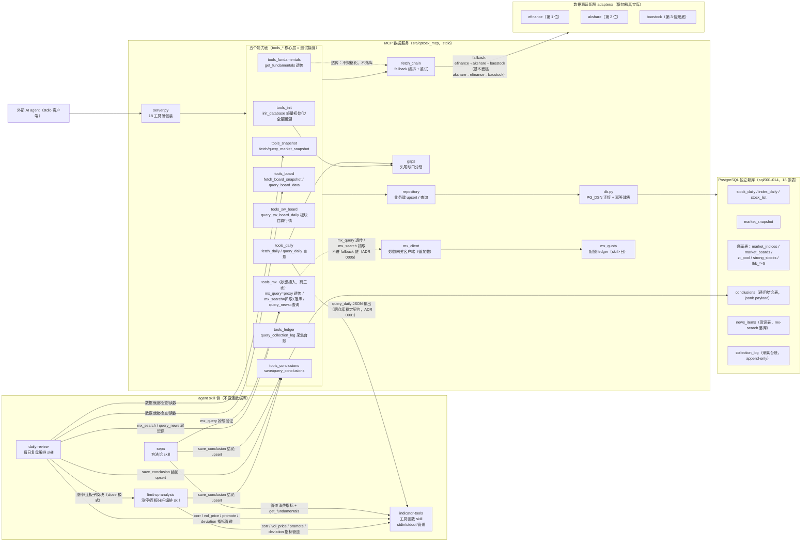

# 项目知识图谱

面向人类与 AI agent 的 5 分钟全图认知。术语遵循 `CONTEXT.md`（抓取/落库/透传/自愈/回溯/五个能力面）。
每条论断尽量标注来源（`path:line`）。设计决策的"为什么"在 `docs/adr/0001-0009`，本图只讲"是什么、在哪、和谁相连"。

## 总览图

## 实体清单

### MCP server 入口与公共层

- **`server.py`**：stdio MCP server，18 个工具只做薄包装，核心逻辑全在 `tools_*` 模块（`src/qstock_mcp/server.py:1-5`）；数据库连接按工具调用建立，启动不依赖 PG 可达（`server.py:4`）。入口 `qstock-mcp = qstock_mcp.server:main`（`pyproject.toml:17`）。
- **`output.py`**：统一错误输出契约——`status:"error"` + 工具名 + 参数回显 + 原因，工具层不抛异常（`output.py:4-6`、`db.py:31-41`）。
- **`dates.py`**：日期统一 `yyyymmdd`（接受 `yyyy-mm-dd`）；`days` 按交易日≈自然日 7/5 加 buffer 换算区间，宁多抓不少抓，换算落点是非交易日时 start 向前对齐到最近交易日（周末 + `_MARKET_CLOSURES` 已知休市表，issue #51）（`dates.py:62-73`、`dates.py:75-97`）。`is_trading_time`/`today_str`：交易时段判定（交易日 09:30–15:00 东八区），盘中禁写防线（issue #78）的判定内核，时钟可注入。
- **`db.py`**：连接串只从 `PG_DSN` 环境变量读（ADR 0002）；`ensure_schema` 幂等执行 `sql/*.sql` 全部 DDL（`db.py:21-28`、`db.py:44-54`）。

### 五个能力面（核心层 = 第一测试接缝，测试注入 fake 适配器 + 真实 PG 测试库）

- **init — `tools_init.py`**：轻量初始化 = 幂等建表 + 股票清单 + 全市场快照 + 7 个主要指数全历史日线，三部分独立成败，输出 `parts`/`failed_parts`，仅全败才整体 `error`（`tools_init.py:1-13`、`tools_init.py:168-219`、ADR 0004）。`backfill_history=True` 显式开启全量回溯：以 `stock_list` 为标的来源、固定 qfq、复用日线头尾自愈、单股失败不中断（`tools_init.py:117-165`）。`query_index_daily` 为 index_daily 纯读查询（issue #33/T1）：index_code 限 7 个主要指数（白名单校验，未知代码 error 并列可选项），日期闭区间 + limit 取最近 N 行（缺省 120）升序返回，空结果 `count:0` 非错误，不触发补抓（`tools_init.py:224-284`）。**能力面归统一查询**（`CONTEXT.md`），实现暂驻 tools_init：与写入方 `_init_index_daily` 同模块共享 `MAJOR_INDICES` 白名单/指数名，迁往 tools_daily 会与 tools_init→tools_daily 的 `ensure_coverage` 依赖成环。`import_board_classification`（issue #73，spec #70）：成分字典显式导入入口，以文件为准清空重载某 source_system（事务内删除后重载、陈旧行不残留、重复执行幂等），本期仅 'sw'（申万 .xls，解析在 `_sw_classify.py` 纯函数、xlrd 懒加载，股票代码补零 6 位）；采集台账挂接点 `_ingest_ledger_hook` 已预留（台账表 #71 落地后接线）。`import_sw_industry_meta`（issue #74）：申万行业名称表种子导入，仓库内置 CSV 种子（`data/sw_industry_meta.csv`，加载在 `_sw_classify.load_sw_industry_meta_seed`）按 industry_code 幂等 upsert，只动 meta 不碰成分变更史；来源验证与合并规则见 `docs/research/2026-10-17-sw-industry-meta-sources.md`。
- **fetch/query 日线 — `tools_daily.py`**：`ensure_coverage` 只补请求区间头尾缺口（中段缺口视为停牌），是全量回溯与查询自愈共用的公共能力（`tools_daily.py:24-48`）；`fetch_daily` 与 `query_daily` 共用 `_run` 骨架（参数解析→连接→自愈），前者报告 upsert 行数，后者返回完整区间行（`tools_daily.py:67-147`）。盘中禁写（issue #78）：交易时段内当日行不落库（defer 机制，fetch 报告 deferred 计数、query 把盘中行随响应返回并带 note）。停牌标注（issue #80）：`query_daily` 每行带 `tradestatus`（baostock 权威，其余源 null）+ `suspended`/`suspended_basis`（tradestatus 优先，OHLC 全等且 volume/change_percent 为 null 的启发式兜底），停牌占位行与数据缺失行由此可区分。
- **fetch/query 快照 — `tools_snapshot.py`**：全市场快照单次调用约 5000+ 只；交易日优先级：API 报告 > 传入参数 > 当天，但传入日期与 API 生效日期不符（含 API 未报告）即 error + `detail:date_mismatch` 零落库（issue #78 防线，"API 优先"仅限不传参）（`tools_snapshot.py:80-85`）。三态错误契约首个落地（issue #46，ADR 0007）：全源失败按逐源 `failure_kind` 聚合 `error_kind`——任一抓取源连接级故障即 `upstream_unreachable`（带 `retry_advice`），否则 `fetch_failed`；by-design 不支持的源不参与判定；上游正常响应空结果为 `no_data_for_date`（status ok + `empty_kind` + note，非失败）。`query_snapshot` 服务端聚合与排序取前 N（issue #48）：`aggregate=breadth,amount` 聚合模式返回上涨/下跌/平盘家数（最新价 vs 昨收判定，含沪/深/北分市场口径——代码前缀 6 沪 / 4·8·9 北，同 `is_bse_code` / 其余深）与成交额合计（万元，ADR 0006），不返回行，环比由调用方对当日/前一日各调一次完成；`order_by`（快照列白名单）+ `limit=N` 排序取前 N（`order` asc/desc 缺省 desc），行字段与整表查询一致不裁剪列；聚合与 ORDER BY/LIMIT 均下推 SQL，新参数与 `trade_date`/`stock_code` 正交、不传行为不变；明确不做通用 offset 分页（防翻页拼全表）。
- **fetch/query 盘面 — `tools_board.py`**：五 section（indices/boards/zt_pool/strong_stocks/lhb）独立 fallback、独立 commit 落库（中途失败不回滚、按 trade_date 幂等、可用 sections 参数分段重试）。核心 section 集显式声明为 `CORE_SECTIONS = indices/boards/zt_pool/strong_stocks`（lhb 永不进核心集，issue #47）：任一核心 section 因 upstream_unreachable 失败即整体 error，响应携带 per-section 明细（成败/已落库行数/error_kind/逐源 attempted_sources）；fetch_failed（非连接级）与 no_data_for_date（空结果标 `empty_kind`，非失败）不触发；仅全部失败也整体 error。lhb 空数据返回 rows:0 + note + empty_kind（盘后发布），lhb 抓取失败按三态结构化返回（status error + error_kind + 逐源明细，与"未发布"可区分）但不触发整体 error；lhb 子项部分失败落已得数据并报 `partial_error`（`tools_board.py:55-59`、`tools_board.py:132-238`）。indices 段白名单定点补漏（issue #49）：主源 efinance「沪深系列指数」口径系统性排除科创板系列指数（缺 000688），抓取后对照 `MAJOR_INDICES`（复用 tools_init 清单，单一事实来源）检查覆盖，缺者按单 code 经 `fetch_index_spot_with_fallback` 补抓补落库；白名单全命中零补抓请求。补漏失败不静默也不触发 fail-fast——section 维持 ok，失败按三态分类进 section 结果 `patch.failed` 明细（`aggregate_patch_error_kind`：empty/unsupported 不算抓取故障，任一连接级故障 upstream_unreachable 带 retry_advice，有非连接失败 fetch_failed，全源口径不含 no_data_for_date）（`tools_board.py:91-130`）。服务端防线（issue #78，ADR 0007 补记）：`REALTIME_SECTIONS = indices/boards` 对历史日期拒收（unsupported + `realtime_section_no_backfill`，零落库）；indices 段落库前校验行级日期==请求日期（`date_mismatch` 零落库）；既有测试一律用当日日期（历史日期防线测试在 `tests/test_realtime_section_guard.py`）。
- **统一查询 — `tools_sw_board.py`**：`query_sw_board_daily` 申万板块自算行情（issue #75，spec #70）：point-in-time 成分归属（`sw_industry_class` 中 source_system='sw' 且 effective_date ≤ trade_date 的最新行，`DISTINCT ON` 下推 SQL）× `stock_daily`（固定 adj='qfq'，与 query_daily 缺省一致——板块截面用 change_percent/amount，与复权方式无关，固定 adj 避免一股多行重复计入）单日截面聚合；level=1 按行业码前 2 位补 '0000'、level=2 按前 4 位补 '00'（聚合码形态与 `sw_industry_meta` 的 XX0000/XXXX00 一致，LEFT JOIN 取名，缺失为 null 不报错）。change_pct 成交额加权（change_percent/amount 为 null 的停牌占位行从权重剔除并归一，`FILTER` 子句实现；涨/跌/平家数与加权同一双非 null 口径），amount 合计万元（库内已是万元口径，ADR 0006），stock_count=point-in-time 成分股总数（LEFT JOIN，当日无日线行的成分也计入）、counted_count=参与加权数（差即停牌/无行情数；全行业当日无日线行时该组不出现），字典未覆盖股票（含非 sw 成分）不参与聚合不报错。trade_date 缺省取库内最新交易日；industry_code 过滤接受 2/4 位前缀或 6 位完整码（按尾零对化简为前缀，如 '480000'→'48'；非尾零三级码原样精确匹配），非法值走 error 契约；每行携带 `basis: "sw_amount_weighted"`。
- **proxy — `tools_fundamentals.py`**：基本面透传，`{section: 原始记录}` 键名保留上游、仅 JSON 安全化，不规格化、不连数据库、不落库；全失败 `status:"error"` 绝不伪造（`tools_fundamentals.py:1-8`）。
- **conclusions — `tools_conclusions.py`**：结论读写。写入校验日期与 payload 可 JSON 序列化；同业务键重复写为 upsert，`outcome` 报告 `inserted/updated`（`tools_conclusions.py:21-59`、ADR 0003）。
- **妙想接入 — `tools_mx.py`**：三工具共享 `_mx_exchange` 骨架（配额先检、触顶不调上游、上游触达即记账、code!=0 走统一 error 契约）。`mx_query` 妙想 mx-data 透传（同 proxy 语义：不规格化、不落库、不进 fallback 链）；`mx_search` 资讯搜索并落库 `news_items`（响应内按 news_code 去重、业务键幂等 upsert，subject 缺省 `market`/`_market`）；`query_news` 库内资讯纯读（subject + 发布时间范围过滤、倒序、limit，空结果 `count:0` 非错误，不调上游不计配额）（ADR 0005、`tools_mx.py:60-116`、`tools_mx.py:142-180`、`tools_mx.py:183-230`）。
- **采集台账 — `tools_ledger.py` + `ledger.py`（issue #77，spec #71/W4）**：一切写库路径（fetch_daily/query_daily 自愈、fetch_market_snapshot、fetch_board_snapshot 逐 section、init 各 part、成分字典/名称表导入）每次采集动作落一行 `collection_log`（trade_date/section/status(ok·empty·error)/source/rows/error_kind/detail/起止时间，append-only 全历史保留；`record_collection` 落账失败仅 log 不拖垮主流程）；区间采集（日线）记区间尾日、区间见 detail。`query_collection_log` 按日期/section/状态过滤、完成时间倒序、limit 缺省 100 上限 500（约束输出体量），空结果 `count:0` 非错误。就绪检查语义：无台账行=未采集，empty=上游确认无数据，error=采集失败。
- **调度 CLI — `scheduler.py`（issue #82/#83，spec #71/W5）**：`qstock-scheduler` 入口（pyproject `[project.scripts]`），直调 tools_* 核心层不经 MCP 协议层。子命令 `close [--date]`：收盘后批盘面五 section（boards/zt_pool/strong_stocks/lhb/indices）经 `fetch_board_snapshot` 一次执行，逐 section 独立成败、台账由 tools_board 内联记录（本层不重复落账）；子命令 `morning [--date]`：次晨批（`tools_morning.fetch_morning_batch`，不注册 MCP 工具）——baostock `query_daily_history_k_AStock` 一把抓前一交易日全市场日线（单源不走 fallback 链，失败按三态契约分类落台账；映射 `map_astock_daily_rows`：turn→turnover_rate、adjustflag→adj、volume 股透传、amount→万元、tradestatus 权威列），按业务键 `(stock_code, trade_date, adj)` 幂等落库与头尾自愈不冲突；7 大指数白名单尾行缺失即补（尾行次日~目标日经 fetch_index_daily fallback 链，全量缺者从 1990 起点；尾行已到目标日零请求）；显式 --date 当日且盘中时被防线拒（零落库）。子命令 `backfill [--start --end]`（issue #84，`tools_backfill.fetch_boards_backfill`）：push2his 板块 K 线回补 market_boards（默认窗口 = 前一交易日前推 90 自然日；板块清单取 market_boards 去重板块集；回补行 source='push2his' 与实时采集 NULL 行区分；业务键幂等；逐板块独立成败+落台账；CLI 专用路径不经历史日期防线，仅保留盘中禁写）。close 批附概念成分积累（`tools_backfill.accumulate_em_concepts`）：boards 成功时概念板块 cons 成分入成分字典 'em' 体系（effective_date=当日，ON CONFLICT DO NOTHING），失败不拖垮主批（不影响退出码，独立落台账）。任一部分/section 失败 exit 1（明细在 stdout JSON），参数错误 exit 2，异常收敛为结构化 JSON。重复执行幂等（业务键 upsert）。launchd 安装样例见 `docs/scheduler-launchd.md`（用户自行安装；非交易日触发产生 empty 台账行，属正常语义）。

### 编排与落库

- **`fetch_chain.py`**：fallback 编排核心。每源最多重试 2 次（3 次尝试）；空结果视为成功（停牌/无交易日）不触发 fallback；全失败抛 `AllSourcesFailed` 携带 `attempted_sources`（每源尝试次数、错误与 `failure_kind` 故障分类——unsupported/connection/other，ADR 0007）（`fetch_chain.py:77-104`）。只依赖适配器协议，不感知具体第三方库（`fetch_chain.py:1-9`）。
- **`gaps.py`**：头尾缺口规则——库内已有日期集合的最早/最晚之外才补抓，最多两段（`gaps.py:10-21`）。
- **`repository.py`**：全部 upsert 按业务键幂等。`stock_daily` 键 `(stock_code, trade_date, adj)`、`market_snapshot` 键 `(trade_date, stock_code)`（`repository.py:31-41`、`repository.py:92-103`）；盘面表注册表 `BOARD_SECTION_TABLES`（section→表/日期列/业务键/列集）与 `BOARD_QUERY_TABLES`（可查询表白名单，表名列名只来自内部常量，不接外部输入）（`repository.py:366-386`、`repository.py:434-446`）；`upsert_board_rows` 写入前按业务键去重（last-wins，上游脏数据防御——东财板块同代码重名、yyb 同席位多排名行实测存在），丢弃数记 log.warning。结论 upsert 用 CTE 预查业务键判定 inserted/updated（`repository.py:486-519`）。盘面表基本无 `source` 列（本项目 DDL 决策）；例外：`market_boards.source`（issue #84，sql/015——NULL=实时采集存量行、'push2his'=backfill 回补行）。板块回补与成分积累写入：`upsert_board_history`（行自带逐日 trade_date，业务键 upsert 并写 source）、`select_distinct_boards`（去重板块清单）、`upsert_em_cons`（成分字典 'em' 体系，ON CONFLICT DO NOTHING）。资讯表 `news_items` 业务键 `(news_code, subject_type, subject_code)`（同一资讯可挂多主体），上游缺条目 id 时标题+发布时间复合兜底；`publish_time` 按东八区落 timestamptz；`select_news_items` 发布时间倒序 + 范围过滤 + limit，不返回内部列与 `raw`（`repository.py:581-599`、`repository.py:601-663`、`repository.py:670-709`）。

### 数据源适配层

- **`adapters/base.py`**：协议接缝。六个 Protocol（Daily/Snapshot/Board/Fundamentals/List/IndexDaily）合成 `DataAdapter`；失败一律抛 `FetchError`，返回空列表不是错误（`base.py:174-188`、`base.py:240-329`）。`FetchError(kind="unsupported")` 显式标注 by-design 不支持（不算抓取故障）；`fetch_failure_kind` 沿异常链按类名判定连接级故障（connection/other，ADR 0007 判定内核，`base.py:190-238`）。`BAR_FIELDS` 等列集是行 dict 与落库列的共同词汇（`base.py:20-172`）。北交所代码（4/8/9 开头）`is_bse_code` 明确拒绝（`base.py:330-333`）；`json_safe` 做透传序列化（NaN/numpy/日期→JSON 安全值，不改键名）（`base.py:335-361`）。
- **三个真实适配器**：懒加载第三方库，未安装报明确 `FetchError`（`pyproject.toml:13-14`）。日线/快照/清单链顺序 efinance→akshare→baostock（`adapters/__init__.py:38-44`）；基本面链按数据丰富度排序 akshare→efinance→baostock（`adapters/__init__.py:47-57`）。能力差异：efinance 盘面仅支持 indices（沪深系列指数口径，系统性排除科创板系列）且无干净指数历史接口；akshare 五 section 全支持（东财接口，「沪深重要指数」43 只含科创50）；baostock 无全市场快照、无振幅/换手列（置 null 不伪造）（`efinance_adapter.py:1-2`、`akshare_adapter.py:1-5`、`baostock_adapter.py:1-7`）。`fetch_index_spot`（单 code 指数行情，issue #49 补漏用）：efinance/akshare 复用各自全量口径按 code 过滤（空 = 口径不含该指数，转下一源），baostock 明确 unsupported。
- **`_eastmoney.py` / `_board_em.py`**：东财中文列→落库行 dict 的纯函数映射，不 import 第三方库，测试无需触网；`-`/空/nan 统一映射为 None（`_eastmoney.py:1-6`、`_board_em.py:1-8`）。金额统一规约为万元：元值经 `_wan`、中文金额串（"X亿"/"X万"/无单位按万元）经 `_money_cn`（ADR 0006）。
- **妙想不经适配层**：`mx_client.py` 是独立 HTTP 客户端（懒加载、`MX_APIKEY` 缺失报明确 `MXError`、query/search 两方法各对一个 endpoint，`mx_client.py:20-56`）；`mx_quota.py` 是本地 JSON 配额 ledger（skill×日期计数、默认 20 次/日、环境变量 `MX_DAILY_LIMIT*`/`MX_QUOTA_FILE` 覆盖、时钟与路径可注入，`mx_quota.py:15-54`）。两者只服务 `tools_mx`，不进 fallback 链（ADR 0005）。

### PostgreSQL 表（`sql/001-012`，独立新库，ADR 0002）

- 日线类：`stock_daily`（带 `adj` 与 `source` 列；`tradestatus` 权威停牌列——baostock 路径写入，东财系为 null，issue #80）、`index_daily`（指数与个股分表——`000001` 代码冲突，指数无复权）、`stock_list`（主键 `stock_code`，全量回溯标的来源）（`sql/001`、`sql/010`、`sql/009`、`sql/014`、ADR 0004）。
- 快照类：`market_snapshot`（`sql/002`）。
- 盘面类：`market_indices`/`market_boards`（含 `source` 列：NULL=实时采集、'push2his'=backfill 回补，issue #84，sql/015）/`zt_pool`/`strong_stocks` + lhb 五表（`lhb_basic`/`lhb_stock_detail`/`lhb_stock_statistic`/`lhb_yyb_capital`/`lhb_yyb_most`；`lhb_basic` 业务键 `(trade_date, stock_code, lhb_reason)`——同股当日多榜单按原因各一行；`lhb_stock_detail` 无业务唯一键，仅随父表存在；yyb 两表上游无卖出/净额等列、恒 null 不伪造，`lhb_yyb_most.buy_amount` 口径为"合计动用资金"非纯买入）（`sql/003-007`、`repository.py:370-386`）。
- 金额口径：全库金额列统一万元（成交额/市值/龙虎榜金额等），换算在适配器映射层（`_wan`/`_money_cn`）；基本面透传除外（ADR 0006）。量纲口径：全库 volume 列统一股（东财系手 ×100 经 `_gu`，baostock 透传；ADR 0008）；存量迁移为一次性运维动作（`migrate_volume.py`：`--audit` 机检互证 / `--apply` 分批迁移，天然幂等）。
- `conclusions`：业务唯一键 `(subject_type, subject_code, trade_date, conclusion_type)` 在 schema 层钉死，`payload` 为 jsonb、结构由写入方 skill 自报、server 不校验（`sql/008_conclusions.sql:3-17`、ADR 0003）。
- `news_items`：资讯表（mx-search 落库，ADR 0005）。业务唯一键 `(news_code, subject_type, subject_code)`；列含资讯类型/标题/正文截断/`publish_time`（timestamptz）/来源/链接（可空，研报无原文链接）/研报机构评级（可空）/`raw` jsonb 原文（`sql/011_news_items.sql:1-24`）。
- 成分字典与名称表（issue #72，spec #70）：`sw_industry_class` 多体系同构形态，主键 `(source_system, stock_code, board_code, effective_date)`（'sw'/'em' 等，为东财概念成分预留）；`sw_industry_meta` 行业名称表（`industry_code` 主键 / name / level 1-3），种子数据由 `import_sw_industry_meta` 工具（issue #74）幂等 upsert 灌入。`sql/012` 同时承担现库旧形态（手工建表，主键 `(stock_code, effective_date)`，列 `industry_code`）的幂等迁移：改名 `board_code`、回填 `source_system='sw'`、主键扩为四元组。
- `collection_log`：采集台账（issue #77，append-only 全历史保留），字段与就绪检查语义见 `sql/013_collection_log.sql` 文件头注释与上文 tools_ledger 条目。

### agent skill（`skills/`，第二测试接缝：脚本 stdin/stdout）

- **indicator-tools（工具函数 skill）**：`scripts/indicators.py` 纯标准库，stdin 吃 `query_daily` 输出 JSON（`corr`/`promote`/`deviation` 例外，为专用输入）、stdout 吐指标 JSON，不访问数据库、现算现用不物化（ADR 0001）。指标目录：MA/MACD/BOLL/RSI/diff1/diff2/rolling_max/rolling_min/maxdd/chg/corr（多标的相关性矩阵）/vol_price（量价判定）/promote（晋级率与连板梯队）/deviation（个股对基准指数的偏离值窗口累计，严重异动监控口径，新股前 5 日经 `--skip-leading` 剔除），边界规则（null 头部）随输出 `boundary_rule` 回显。停牌行剔除（issue #81，ADR 0009）：`parse_cols` 入口剔除停牌占位行（标注优先 `suspended=true`/`tradestatus=0`，无标注启发式兜底），不填充不伪造，剔除后必需列校验仍严格，剔除明细记 `excluded_suspended`。退出码 0=ok/insufficient_data（数据不足非错误）、1=输入错误、2=参数错误（`skills/indicator-tools/SKILL.md:20-49`）。测试在 `skills/indicator-tools/tests/`。
- **sepa（方法论 skill）**：判断逻辑为主体，无脚本。取数链路：`query_daily(days=400)` → 管道给 indicator-tools；`get_fundamentals` 取基本面；指数基线不可经 MCP 获得时用 `query_board_data("market_indices")` 快照降级并标注。`count<250` 或数据缺失即报告缺口、不硬算、不编造。结论可经 `save_conclusion(..., conclusion_type="sepa.full")` 落库。妙想验证小节：三源选股后 `mx_query` 抽样复核财务指标（宽问句省配额、单季/累计口径换算、未披露期静默回退须先校验披露状态、按 `secuCode` 过滤港股），验证结论落 `sepa.mx_verified`（`skills/sepa/SKILL.md:12-26`、`skills/sepa/SKILL.md:84-110`）。
- **daily-review（每日复盘编排 skill）**：轻脚本重编排，agent 手写结论 JSON 与 markdown 报告。流程：就绪检查（核心表缺则先补抓；抓取超时/报错后 5s×6 轮询防竞态、分段重试只传失败 `sections`；任一核心 section 或 market_snapshot 抓取 `status=error`（三态契约 ADR 0007）→ 故障中止分支：不落库、落异常报告 `files/daily_review_<date>_anomaly.md`；`market_boards` 当日缺失（非故障，经轮询/分段重试后仍 count=0）→ 板块轮动节整节降级切换申万自算口径（`query_sw_board_daily`，口径标注 + 与东财口径栏目叙述层断交 + 停牌数表述，规则与演练产物见 SKILL.md"板块节降级"节与 `skills/daily-review/examples/daily_review_20261014_board_section_swcalc.md`）；指数历史经 `query_index_daily` 逐指数查 60 根；可选 `mx_search` 搜资讯落库，配额触顶跳过入 `data_gaps`）→ 读数（market_indices 按 7 大指数逐 code 取；market_snapshot 走 `query_snapshot` 聚合 `aggregate=breadth,amount` 与 `order_by=amount,limit=75`，备用落盘通道 `scripts/mcp_dump.py`（stdio 驱动同一 MCP server、结果落盘本地聚合）；含 `query_news` 读近期资讯、market_boards 逐日历史供板块 5/10 日涨跌、mx_query 批量查前 75 概念归属）→ 涨停/连板子模块（close 模式调 limit-up-analysis）→ corr/vol_price/deviation 指标管道（连板股偏离值累计对照交易所严重异动阈值预警）→ 报告落盘 `skills/daily-review/reports/`（资讯引用约定：标题+发布时间+来源，链接可空兜底）→ `save_conclusion(subject_type="market", subject_code="_market", conclusion_type="daily_review.<mode>")`（payload 必含 `report_path`）→ 落库失败即中止，不算复盘完成。报告骨架：总体立场（≤5 行摘要）+ 六节（指数表现 / 板块轮动 / 涨停连板与龙虎榜 / 成交额前 75 / 归因与量价复盘 / 风险提示仅增量），数据点全报告唯一出处。技能不内置调度，收盘后定时执行的现成 launchd/cron 配置见 SKILL.md 末节（`skills/daily-review/SKILL.md:17-67`、`skills/daily-review/SKILL.md:110-128`、`skills/daily-review/SKILL.md:130-148`）。
- **limit-up-analysis（涨停/连板分析编排 skill）**：轻脚本重编排，可单独调用、也被 daily-review（close 模式）编排调用。晋级率与连板梯队只认 indicator-tools `promote` 管道输出（不手算）；归因三维（板块聚类/大小票/业绩题材粗分）与龙头点评由 agent 基于盘面/快照/资讯生成。不写独立报告文件：结论落库 `limit_up.close`（`summary` 供 daily-review 原样引用），分析文本在对话内呈现；落库失败即中止（`skills/limit-up-analysis/SKILL.md:18-44`、`skills/limit-up-analysis/SKILL.md:58-77`）。

### 测试与协作

- **`tests/`**：`conftest.py` 的 `pg_test` fixture 连真实 PG 测试库 `qstock_test`（不可达自动 skip，`QSTOCK_TEST_PG_DSN`/`QSTOCK_TEST_MAINT_DSN` 可覆盖）；清库走 `reset_test_db`——DROP SCHEMA 前先 `pg_terminate_backend` 清掉本库残留会话，上个用例断言失败泄漏的连接不会阻塞后续 fixture（issue #30）（`tests/conftest.py:27-58`）；`fakes.py` 的 fake 适配器与真实适配器实现同一协议，另含 `FakeMxClient` 与 mx 实测响应 fixture。测试直接打 `tools_*` 核心层，不经 MCP 协议层；mx 三工具的接缝在 `test_mx_tools.py` / `test_mx_search.py` / `test_query_news.py` / `test_mx_quota.py`。
- **协作面**：issue 走 GitHub Issues（`gh` CLI），triage 标签与 domain docs 消费约定见 `docs/agents/`（`AGENTS.md:1-13`）。`.agents/skills/` 下的协作 skill（来自 `skills-lock.json`）仅服务本仓库开发流程，不属于交付物。

## 关键流程

- **查询自愈（头尾缺口）**：`query_daily`/`fetch_daily` → `resolve_range` 解析区间 → `select_dates` 取库内已有日期 → `head_tail_gaps` 算头尾分段（最多两段，中段缺口=停牌）→ 逐段 `fetch_with_fallback` → `upsert_daily` → `select_daily` 返回完整区间，自愈分段在输出 `healed`/`segments` 中报告（`tools_daily.py:67-99`、`gaps.py:10-21`）。
- **fallback 与重试**：每种抓取（日线/快照/五 section/基本面/清单/指数日线）各有一个 `fetch_*_with_fallback`，共享同一 `_with_fallback` 内核：按链顺序尝试、每源 3 次尝试、空结果即成功、全失败抛 `AllSourcesFailed`（`fetch_chain.py:105-262`）。例外：`fetch_index_spot_with_fallback`（单 code 指数补漏，issue #49）空结果（源口径不含该指数，failure_kind "empty"）不视为成功、立即转下一源不重试，error_kind 用 `aggregate_patch_error_kind` 判定；`empty` 作为补漏路径专用第四个逐源 failure_kind 的正式口径（语义与边界）见 ADR 0007 补记。
- **section 级独立成败**：`fetch_board_snapshot` 与 `init_database` 同构——逐项独立 fallback、逐项成败进 `sections`/`parts`，仅全部失败才整体 `error`；board 侧另有核心 section fail-fast（issue #47）：核心 section 因 upstream_unreachable 失败即整体 error 并携带 per-section 明细，中途失败不回滚、按 trade_date 幂等、可用 sections 参数分段重试（`tools_board.py:132-238`、`tools_init.py:192-219`）。整把重试方式就是再调一次（幂等，ADR 0004）。
- **结论 upsert**：业务键在 schema 层钉死；CTE 预查判定 `inserted/updated`；payload 不校验，结论类型（`daily_review.close`、`sepa.full` 等）的字段约定由各 skill 文档承载（ADR 0003）。
- **mx 调用与资讯沉淀**：`mx_query`/`mx_search` 走 `_mx_exchange` 骨架——配额先检（触顶不调上游直接 error）→ 调上游 → 触达即记账 → 业务码判定（code!=0 走 error 契约）；`mx_search` 成功即按 news_code 去重并业务键 upsert `news_items`；`query_news` 纯读库（倒序 + limit），不经骨架、不计配额（`tools_mx.py:60-116`、`tools_mx.py:142-230`）。
- **skill 间数据流**：`query_daily` JSON（跨仓库稳定契约，ADR 0001）→ indicator-tools stdin → 指标 JSON → 方法论 skill（sepa）判断 → `save_conclusion`；编排 skill 同样经管道消费指标（daily-review 用 corr/vol_price/deviation，limit-up-analysis 用 promote，专用输入按各自契约组装）；daily-review 的涨停/连板章节取自 limit-up-analysis 落库的 `limit_up.close` 结论。

## 入口指引（想改 X 先看哪里）

- **改表结构/schema**：`sql/00X_*.sql`（DDL 拥有权在本项目）→ `repository.py`（列集/业务键/注册表）→ `adapters/base.py` 的 `*_FIELDS` → 相关 ADR（0002 选型、0003 结论表、0004 init 表）。改完跑 `tests/test_repository.py` + 对应 fetch/query 测试。
- **改 `query_daily` 输出结构**：这是跨仓库稳定契约（ADR 0001）——`tools_daily.py` + `skills/indicator-tools/SKILL.md` 输入契约 + `skills/indicator-tools/tests/` 必须同步，变更需谨慎。
- **加数据源**：实现 `adapters/base.py` 的协议 → 新建 `adapters/<name>_adapter.py` → 调整 `adapters/__init__.py` 两条链的顺序 → `tests/fakes.py`/`test_adapters.py` 覆盖。
- **加盘面 section/表**：`sql/` 新 DDL → `repository.BOARD_SECTION_TABLES`/`BOARD_QUERY_TABLES` → `BoardAdapter` 协议与 `_board_em.py` 映射 → `tools_board.ALL_SECTIONS`。
- **加指标**：只动 `skills/indicator-tools/scripts/indicators.py` 与其测试，不改 MCP server（ADR 0001）；新增指标不得改变既有契约（`skills/indicator-tools/SKILL.md:95`）。
- **加结论类型**：零 schema 变更（ADR 0003），只在对应 skill 文档约定 payload 字段并调用 `save_conclusion`。
- **改涨停/连板分析**：编排逻辑与归因口径在 `skills/limit-up-analysis/SKILL.md`；晋级率/梯队数字只认 indicator-tools 的 `promote` 输出，改口径走"加指标"路径。每日复盘收盘后定时执行：技能不内置调度，现成 launchd/cron 配置见 `skills/daily-review/SKILL.md` 末节。
- **加 MCP 工具**：核心逻辑进 `tools_<面>.py`（可注入适配器、返回自描述 dict），`server.py` 只加薄包装；测试打核心层。
- **改妙想接入/资讯**：边界在 ADR 0005——`tools_mx.py`（三工具与 `_mx_exchange` 骨架）→ `mx_client.py`/`mx_quota.py`（客户端与配额 ledger）→ `sql/011_news_items.sql` 与 `repository.py` 资讯段；测试 `tests/test_mx_tools.py`/`test_mx_search.py`/`test_query_news.py`/`test_mx_quota.py`（fake 注入 + 真实 PG 测试库，不触网）；消费方守则在 `skills/sepa/SKILL.md`、`skills/daily-review/SKILL.md`。
- **改 fallback/重试策略**：`fetch_chain.py`（注意"最多 3 次"按尝试次数口径，`fetch_chain.py:24`、`fetch_chain.py:96`）+ `tests/test_fetch_chain.py`；错误分类（failure_kind/三态契约）的判定标准与约束力在 ADR 0007，落地先例 `tests/test_snapshot_error_contract.py`。
